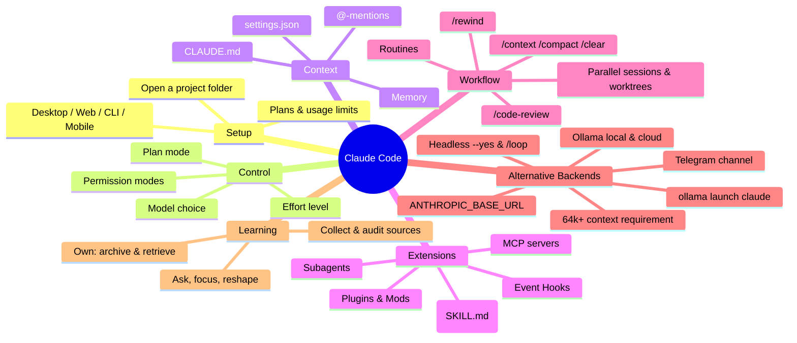
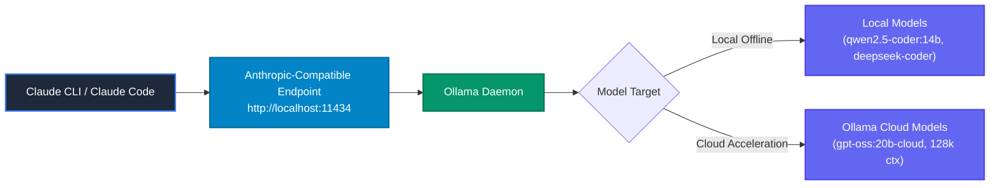
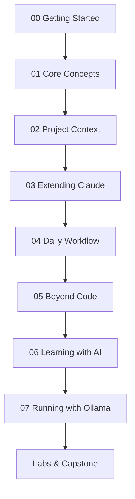

<div align="center">
  <h1>Claude-Ollama-Coder</h1>
  <p><strong>The Complete Tutorial, Hands-on Course & Architecture Reference for Claude Code with Ollama Local Models</strong></p>
  <p>
    <a href="https://cagricatik.github.io/claude-ollama-coder/">
      
    </a>
    <a href="https://ollama.com/">
      
    </a>
    <a href="https://docs.anthropic.com/en/docs/claude-code">
      
    </a>
    
    
    
  </p>
</div>

---

## Overview

**Claude-Ollama-Coder** provides a unified, production-ready environment that combines:

1. **The Complete Claude Code Tutorial & Course**: An 8-module progressive curriculum (Modules 00–07) paired with 10 hands-on labs, a comprehensive capstone project, and starter project templates.
2. **Local & Cloud Inference Engine via Ollama**: Complete cross-platform automation and scripts that redirect the Claude CLI / Claude Code to an Anthropic-compatible Ollama endpoint (`http://localhost:11434`), enabling zero-cost, private, offline-capable agentic coding.
3. **Deep Technical Reference Library**: An in-depth reference suite covering the Claude API, Model Context Protocol (MCP), Subagent Orchestration, and reusable Agent Skills, published via MkDocs Material to [GitHub Pages](https://cagricatik.github.io/claude-ollama-coder/).
4. **14 Conforming Agent Skills**: Production behavioral guidelines and execution modules strictly adhering to the open [Anthropic Agent Skills standard](https://agentskills.io).

> **Note on accuracy:** Claude Code's UI, model names, and features evolve rapidly. When a specific detail matters, consult the official documentation at <https://docs.anthropic.com/en/docs/claude-code> and the Ollama model library at <https://ollama.com/library>.

---

## The Big Picture



---

## Architecture

Claude CLI normally connects to Anthropic's hosted cloud API. In this unified setup, the CLI environment is pointed at Ollama on `localhost:11434`, which serves open-weights coding models locally or connects to Ollama Cloud.



---

## Quick Start (Cross-Platform)

### 1. Prerequisites
- [Ollama](https://ollama.com/) installed and running (`ollama serve`)
- [Claude Code CLI](https://docs.anthropic.com/en/docs/claude-code) (`claude`) installed
- Python 3.10+ (for documentation and SDK labs)

### 2. Automated Setup & Launcher

#### macOS & Linux
```bash
# Automated setup (checks Ollama, Claude CLI, registers cloud models):
./setup-ollama.sh

# Interactive launcher: prompts you to pick from all available local & cloud models:
./run-claude.sh
# (or ./run-claude or ./launch-claude-ollama.sh)

# Or launch directly with a specific model:
./run-claude.sh beam:cloud
./run-claude.sh gpt-oss:20b-cloud
./run-claude.sh qwen2.5-coder:14b
```

#### Windows
```bat
:: Interactive launcher (shows available Ollama models to pick from)
run-claude.bat

:: Or specify a model directly
run-claude.bat beam:cloud
run-claude.bat qwen2.5-coder:14b
```

### 3. Manual Configuration

You can configure your shell environment manually or copy [`.env.example`](.env.example) to `.env`:

```bash
export ANTHROPIC_BASE_URL=http://localhost:11434
export ANTHROPIC_AUTH_TOKEN=ollama
export ANTHROPIC_API_KEY=""

# Run Claude Code with your chosen model
claude --model qwen2.5-coder:14b -p "Explain this repository"
```

---

## 🎓 The Interactive Course Curriculum

A hands-on, structured learning path taking you from installation to an advanced, production-grade Claude Code workspace:



### How to Use This Course
1. Read through a module in [`docs/tutorials/`](docs/tutorials/), then complete the matching hands-on lab in [`docs/tutorials/labs/`](docs/tutorials/labs/README.md).
2. Copy configured scaffolding from [`examples/starter-project/`](examples/starter-project/) into your own codebases.
3. Keep [`CHEATSHEET.md`](CHEATSHEET.md) open while working.

> **💡 The Golden Rule:** You don't have to memorize any of this. You only need to know a feature *exists* — then you can ask Claude to set it up for you.

---

### Module Breakdown

| Level | Module | Lessons & Integrated Deep Dives |
|---|---|---|
| 🟦 **Beginner** | [**00 Getting Started**](docs/tutorials/00-getting-started/README.md) | Where Claude runs, desktop UI tour, plans & usage limits |
| 🟦 **Beginner** | [**01 Core Concepts**](docs/tutorials/01-core-concepts/README.md) | Prompting, models, effort levels, plan mode.<br>• *Deep Dives:* [Claude 101 API](docs/tutorials/01-core-concepts/06-claude-101-api-fundamentals.md), [AI Fluency](docs/tutorials/01-core-concepts/07-ai-fluency-framework.md) |
| 🟧 **Intermediate** | [**02 Project Context**](docs/tutorials/02-project-context/README.md) | `CLAUDE.md`, memory, `settings.json`, referencing files and comments with `@` |
| 🟧 **Intermediate** | [**03 Extending Claude**](docs/tutorials/03-extending-claude/README.md) | Skills (`SKILL.md`), subagents, MCP servers, event hooks.<br>• *Deep Dives:* [MCP Guide](docs/tutorials/03-extending-claude/06-mcp-expert-guide.md), [Advanced MCP](docs/tutorials/03-extending-claude/07-mcp-advanced-patterns.md), [Agent Skills](docs/tutorials/03-extending-claude/08-agent-skills-guide.md), [Subagents](docs/tutorials/03-extending-claude/09-subagents-architecture.md), [Skills Ref](docs/tutorials/03-extending-claude/10-skills-deep-dive.md) |
| 🟩 **Advanced** | [**04 Daily Workflow**](docs/tutorials/04-daily-workflow/README.md) | Context management (`/compact`, `/clear`), `/rewind`, parallel worktrees.<br>• *Deep Dive:* [Claude Code in Action](docs/tutorials/04-daily-workflow/06-claude-code-in-action.md) |
| 🟩 **Advanced** | [**05 Beyond Code**](docs/tutorials/05-beyond-code/README.md) | Projects, connectors, Cowork, Claude Design → Claude Code.<br>• *Deep Dive:* [Building with Claude API & RAG](docs/tutorials/05-beyond-code/06-building-with-claude-api-and-rag.md) |
| 🟦 **Applied** | [**06 Learning with AI**](docs/tutorials/06-learning-with-ai/README.md) | Collect → Understand → Own: deep research with AI + notebook archives |
| 🟧 **Alternative** | [**07 Running with Ollama**](docs/tutorials/07-running-with-ollama/README.md) | Local hardware, Ollama Cloud, 64k+ context, headless CI (`--yes`), `/loop`, Telegram channels, Storybook screenshot loops |

### Hands-on Labs & Capstone

Work through matching exercises in [`docs/tutorials/labs/`](docs/tutorials/labs/README.md):

- [**Lab 01**](docs/tutorials/labs/lab-01-first-project.md): First Project setup & inspection
- [**Lab 02**](docs/tutorials/labs/lab-02-plan-mode.md): Plan Mode for non-destructive design
- [**Lab 03**](docs/tutorials/labs/lab-03-claude-md.md): `CLAUDE.md` standing instructions
- [**Lab 04**](docs/tutorials/labs/lab-04-settings.md): `.claude/settings.json` permissions
- [**Lab 05**](docs/tutorials/labs/lab-05-skill.md): Writing your first custom Skill
- [**Lab 06**](docs/tutorials/labs/lab-06-subagent.md): Creating a specialist Subagent
- [**Lab 07**](docs/tutorials/labs/lab-07-hook.md): Event Hooks for notifications and security
- [**Lab 08**](docs/tutorials/labs/lab-08-parallel.md): Parallel sessions with Git worktrees
- [**Lab 09**](docs/tutorials/labs/lab-09-learning-workflow.md): The Collect-Understand-Own learning archive
- [**Lab 10**](docs/tutorials/labs/lab-10-ollama.md): Full Ollama local integration
- [**Capstone**](docs/tutorials/labs/capstone.md): Complete end-to-end workspace build

---

## Reference Guides & Cheatsheets

We provide complementary reference documents tailored for different engineering tasks:

1. [**`CHEATSHEET.md`**](CHEATSHEET.md) — **Daily CLI Quick Reference**:
   Slash commands (`/init`, `/context`, `/compact`, `/rewind`, `/loop`), permission modes, Ollama CLI reference, and everyday keyboard shortcuts.
2. [**`docs/tutorials/unified-cheatsheet.md`**](docs/tutorials/unified-cheatsheet.md) — **Technical & API Reference**:
   Token budgets, prompt caching, tool use schemas, SDK parameters, and architectural decision tables.
3. [**`GLOSSARY.md`**](GLOSSARY.md) — Fast terminology lookup linking directly to course lessons.

---

## 📚 Technical Reference Documentation (MkDocs)

The comprehensive documentation suite lives in [`docs/`](docs/) and is hosted on [GitHub Pages](https://cagricatik.github.io/claude-ollama-coder/):

- **[Course Curriculum Overview](docs/tutorials/index.md)** — Full curriculum summary on the docs site
- **[Unified Cheatsheet](docs/tutorials/unified-cheatsheet.md)** — Production habits & prompt engineering
- **[Claude 101](docs/tutorials/01-core-concepts/06-claude-101-api-fundamentals.md)** — API fundamentals, multi-turn dialogues, streaming
- **[AI Fluency Framework](docs/tutorials/01-core-concepts/07-ai-fluency-framework.md)** — Cognitive model, evaluation & clarity
- **[Model Context Protocol (MCP)](docs/tutorials/03-extending-claude/06-mcp-expert-guide.md)** — MCP primitives, server architecture, resources
- **[Advanced MCP Patterns](docs/tutorials/03-extending-claude/07-mcp-advanced-patterns.md)** — Streaming, custom transports, multi-server resilience
- **[Agent Skills](docs/tutorials/03-extending-claude/08-agent-skills-guide.md)** — Extending autonomous agent behaviors
- **[Subagents & Orchestration](docs/tutorials/03-extending-claude/09-subagents-architecture.md)** — Multi-agent delegation, protocols, pipelines
- **[Skills Reference](docs/tutorials/03-extending-claude/10-skills-deep-dive.md)** — `SKILL.md` format, triggers, and marketplace patterns
- **[Claude Code in Action](docs/tutorials/04-daily-workflow/06-claude-code-in-action.md)** — Complete mechanics of coding assistants & hooks
- **[Building with the Claude API](docs/tutorials/05-beyond-code/06-building-with-claude-api-and-rag.md)** — Tool use, embeddings, RAG architectures

### Running Documentation Locally

**Using the included helper scripts (recommended):**
- **macOS / Linux**:
  ```bash
  ./run-mkdocs.sh
  ```
- **Windows**:
  ```bat
  run-mkdocs.bat
  ```

**Or manually via virtual environment:**
```bash
# 1. Activate the virtual environment
source .venv/bin/activate

# 2. Start live preview server at http://127.0.0.1:8000
mkdocs serve
```

*(Alternatively, run directly without activating: `.venv/bin/mkdocs serve`)*

---

## Skills Library & Agent Skills

All skills conform to the [Anthropic Agent Skills standard](https://agentskills.io) and are registered in [`.claude-plugin/marketplace.json`](.claude-plugin/marketplace.json). Detailed authoring instructions, progressive disclosure lifecycle diagrams, and validation details are in [`skills/README.md`](skills/README.md).

- [`skills/_template/`](skills/_template/): Canonical template for authoring new conforming skills, with validation scripts and progressive disclosure references.
- [`skills/agent-to-agent/`](skills/agent-to-agent/): Multi-agent orchestration, supervisor-worker topologies, structured message envelopes, subagent state handoffs.
- [`skills/claude-code-workflows/`](skills/claude-code-workflows/): Plan mode (`/plan`), context compacting (`/compact`), slash commands, subagents, and headless automation (`claude -p`).
- [`skills/ollama-claude-bridge/`](skills/ollama-claude-bridge/): Pointing Claude Code to local Ollama endpoints, environment setup, model tags, and tool-calling compatibility.
- [`skills/mcp-builder/`](skills/mcp-builder/): Building Model Context Protocol (MCP) servers in Python (FastMCP) or TypeScript, stdio/SSE transports.
- [`skills/ollama-modelfile-tuning/`](skills/ollama-modelfile-tuning/): Ollama Modelfile tuning (64k+ context `num_ctx`, sampling parameters, stop tokens, GPU layer offloading).
- [`skills/git-workflow/`](skills/git-workflow/): Conventional Commits, Co-Authored-By attribution, Git Worktrees for parallel sessions, PR templates.
- [`skills/secure-coding/`](skills/secure-coding/): Injection prevention, path traversal defense, secret protection, input validation with Pydantic.
- [`skills/python-modern-practices/`](skills/python-modern-practices/): Python 3.10+ typing (`X | None`), Protocols, Pydantic v2 models, async httpx, pytest fixtures.
- [`skills/api-design/`](skills/api-design/): RESTful API architecture, RFC 7807 Problem Details schemas, cursor pagination, idempotency headers.
- [`skills/karpathy-guidelines/`](skills/karpathy-guidelines/): Guidelines to reduce common LLM coding mistakes (surgical edits, explicit assumptions, test loops).
- [`skills/ros2/`](skills/ros2/): ROS2 robotics development (Python rclpy, C++ rclcpp, launch files, QoS).
- [`skills/software-architecture/`](skills/software-architecture/): System design, component boundaries, ADRs, scalability patterns.
- [`skills/software-engineering/`](skills/software-engineering/): API design, clean code practices, error handling contracts.

**Validate Conformance:**
```bash
python3 skills/_template/scripts/validate_skill.py skills
```

---

## Starter Examples

- [`examples/starter-project/`](examples/starter-project/): Complete `.claude/` template featuring `settings.json`, subagents (`code-reviewer`, `test-runner`), hooks (`notify.sh`, `block-secrets.sh`), and skills.
- [`examples/learning-archive/`](examples/learning-archive/): Ready-to-copy research archive template for Module 06.
- [`examples/agent-dispatcher/`](examples/agent-dispatcher/): A2A task dispatcher microservice with structured envelope patterns and RFC 7807 error handling (built with `nemotron-3-ultra:cloud`).
- [`examples/swarm-coordinator/`](examples/swarm-coordinator/): Hexagonal micro-swarm coordinator with fail-closed pre-execution audit gating, symmetric A2A JSON-RPC, and SSE event streaming (built with `beam:cloud`).

---

## Repository Layout

```text
claude-ollama-coder/
├── README.md                      ← Master unified portal & complete curriculum map
├── CHEATSHEET.md                  ← Daily CLI slash commands & shortcuts reference
├── GLOSSARY.md                    ← Course vocabulary with module lesson links
├── .env.example                   ← Environment template for endpoints & model selection
│
├── setup-ollama.sh                ← Automated macOS/Linux setup & verification script
├── install-ollama-cloud-models.sh ← Pull/register Ollama cloud models (beam, nemotron, etc.)
├── run-claude.sh                  ← Interactive macOS/Linux Claude Code launcher with model picker
├── launch-claude-ollama.sh        ← Quick launcher shortcut (delegates to run-claude.sh)
├── run-claude.bat                 ← Windows interactive Claude Code launcher with Ollama
├── run-mkdocs.sh                  ← macOS/Linux MkDocs live preview server launcher
├── run-mkdocs.bat                 ← Windows MkDocs live documentation server launcher
│
├── requirements.txt               ← Python dependencies for Ollama SDK & lab exercises
├── requirements-docs.txt          ← Documentation build dependencies (MkDocs Material)
├── mkdocs.yml                     ← MkDocs configuration & unified navigation tree
│
├── .claude-plugin/                ← Claude Code plugin & marketplace registration
│   └── marketplace.json           ← Manifest declaring all 13 agent skills
│
├── docs/                          ← Unified documentation hub (MkDocs source)
│   ├── index.md                   ← Documentation homepage
│   ├── stylesheets/extra.css      ← Claude aesthetic stylesheet (Terracotta & Dark Slate)
│   ├── javascripts/extra.js       ← Theme-aware Mermaid initialization & enhancements
│   └── tutorials/                 ← Complete structured course & deep dives
│       ├── index.md               ← Course overview & learning path
│       ├── unified-cheatsheet.md  ← Comprehensive technical reference
│       ├── 00-getting-started/    ← Module 00: Setup, UI, limits
│       ├── 01-core-concepts/      ← Module 01: Prompting, models + Claude 101, AI Fluency
│       ├── 02-project-context/    ← Module 02: CLAUDE.md, settings, memory, referencing
│       ├── 03-extending-claude/   ← Module 03: Skills, agents, MCP + deep specifications
│       ├── 04-daily-workflow/     ← Module 04: Context, rewind, review + Code in Action
│       ├── 05-beyond-code/        ← Module 05: Projects, connectors + Claude API & RAG
│       ├── 06-learning-with-ai/   ← Module 06: Collect → Understand → Own
│       ├── 07-running-with-ollama/← Module 07: Local models, headless, 64k+
│       └── labs/                  ← Hands-on exercises (Lab 01 to Lab 10 + Capstone)
│
├── examples/                      ← Starter templates & microservices (agent-dispatcher, swarm-coordinator)
└── skills/                        ← Reusable Agent Skills adhering to Anthropic specification
    ├── README.md                  ← Authoring guide & skills architecture documentation
    ├── _template/                 ← Canonical template, references, and validate_skill.py
    ├── agent-to-agent/            ← Multi-agent orchestration, envelopes & handoffs
    ├── agentswarm-engineer/       ← Hexagonal swarm engineering, fail-closed audit & A2A protocol
    ├── api-design/                ← REST API design & RFC 7807 error standards
    ├── claude-code-workflows/     ← Plan mode, /compact, slash commands & worktrees
    ├── git-workflow/              ← Conventional Commits, worktrees, PR summaries
    ├── karpathy-guidelines/       ← Avoiding common LLM pitfalls (Karpathy guidelines)
    ├── mcp-builder/               ← FastMCP & TypeScript MCP server development
    ├── ollama-claude-bridge/      ← Local Ollama routing, env vars & troubleshooting
    ├── ollama-modelfile-tuning/   ← Modelfile 64k ctx, sampling parameters, stop tokens
    ├── python-modern-practices/   ← Python 3.10+ typing, Pydantic v2, httpx, pytest
    ├── ros2/                      ← ROS2 node design, QoS, launch files, colcon
    ├── secure-coding/             ← Injection defense, path traversal, secret masking
    ├── software-architecture/     ← Macro patterns, ADRs, cohesion & coupling
    └── software-engineering/      ← Interfaces, error hierarchies, domain layout
```

---

## Notes on Local Model Selection

When running Claude Code with Ollama, note that:
- **Context Window**: Claude Code requires a large context window. Ensure your model is configured with at least `64k` tokens (`num_ctx 65536` in Modelfile or Ollama configuration).
- **Tool Calling**: Ensure your chosen model supports tool use. Cloud-backed models like `gpt-oss:20b-cloud` and `gpt-oss:120b-cloud` provide 128k context and robust function calling with 0 MB disk usage.
- **Offline Local**: For local offline work, recommended models include `qwen2.5-coder:14b`, `qwen2.5-coder:32b`, and `deepseek-coder-v2:16b`.