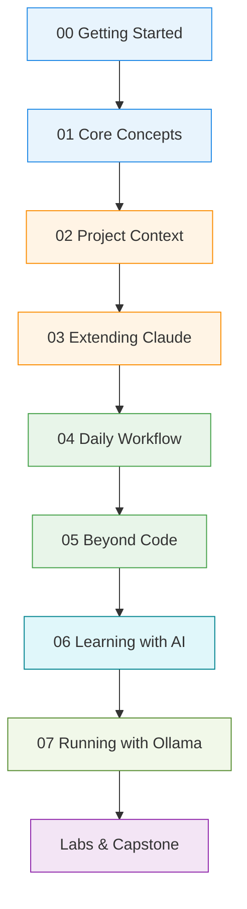
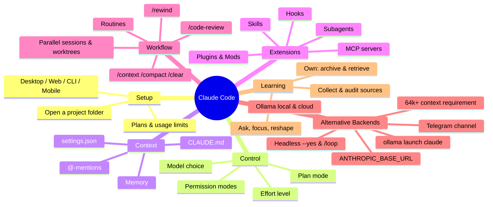

# Claude Code — The Complete Tutorial

A structured, hands-on course that takes you from a fresh install to an advanced, well-configured Claude Code workspace. It is distilled from three video walkthroughs and reorganized into short modules you can work through in order or use as a reference.

> **Note on accuracy:** Claude's UI, model names and features change often. Everything here reflects the state described in the source videos (autumn 2026). When a detail matters, check the official docs at <https://docs.claude.com>.

---

## Learning path



| Level | Module | You will learn |
|---|---|---|
| 🟦 Beginner | [00 Getting Started](00-getting-started/) | Where Claude runs, plans & limits, desktop UI tour |
| 🟦 Beginner | [01 Core Concepts](01-core-concepts/) | Prompting, models, effort levels, permission modes, plan mode |
| 🟧 Intermediate | [02 Project Context](02-project-context/) | `CLAUDE.md`, memory, `settings.json`, referencing files |
| 🟧 Intermediate | [03 Extending Claude](03-extending-claude/) | Skills, subagents, MCP, hooks, plugins & mods |
| 🟩 Advanced | [04 Daily Workflow](04-daily-workflow/) | Context management, rewind, parallel sessions, worktrees, code review, routines |
| 🟩 Advanced | [05 Beyond Code](05-beyond-code/) | Projects, connectors, Cowork, Claude Design → Claude Code, building your own tools |
| 🟦 Applied | [06 Learning with AI](06-learning-with-ai/) | Collect → Understand → Own: learn any topic fast with Claude + a research notebook, and keep it in an archive |
| 🟧 Alternative | [07 Running with Ollama](07-running-with-ollama/) | Connect to local hardware or Ollama Cloud, 64k+ context, headless CI (`--yes`), `/loop`, Telegram channel |
| 🟪 Practice | [labs/](labs/) | Ten hands-on exercises + a capstone |

## Repository layout

```text
claude-code-tutorial/
├── README.md                 ← you are here
├── CHEATSHEET.md             ← one-page command & config reference
├── GLOSSARY.md               ← all the terms in one place
├── requirements.txt          ← Python dependencies (ollama, oterm, rich, anthropic)
├── .env.example              ← template for endpoints & model config
├── progress-dashboard.html   ← interactive visual course progress tracker (open in browser)
├── setup-ollama.sh           ← automated Ollama + Claude Code setup script
├── launch-claude-ollama.sh   ← shortcut launcher for Ollama models
├── 00-getting-started/
├── 01-core-concepts/
├── 02-project-context/
├── 03-extending-claude/
├── 04-daily-workflow/
├── 05-beyond-code/
├── 06-learning-with-ai/
├── 07-running-with-ollama/
├── labs/                     ← hands-on exercises
└── examples/
    ├── starter-project/      ← a fully configured .claude/ folder to copy
    └── learning-archive/     ← template archive for Module 06
```

## The big picture



## How to use this course

1. Read a module, then do the matching lab in [`labs/`](labs/).
2. Copy pieces from [`examples/starter-project/`](examples/starter-project/) into your own projects.
3. Keep [`CHEATSHEET.md`](CHEATSHEET.md) open while you work.

**Golden rule from the videos:** you don't have to memorize any of this. You only need to know a feature *exists* — then you can ask Claude to set it up for you.
