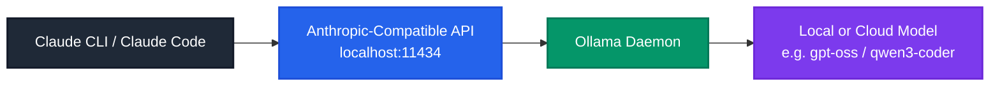

# Claude-Ollama-Coder

> Use the **Claude CLI & Claude Code** with **local and cloud models served by Ollama**.

This setup redirects the Anthropic-compatible endpoint used by Claude CLI to an **Ollama server** (local or cloud-backed), keeping the fast, autonomous terminal workflow while running open models on your own machine.

## Why this exists

This repository combines two complete tracks:
1. **Interactive Course Curriculum**: A step-by-step hands-on tutorial covering Claude Code fundamentals, project context, skills, subagents, MCP, daily workflows, learning loops, and Ollama integration.
2. **Deep Technical Reference Library**: In-depth architecture specifications, API patterns, prompt engineering frameworks, and MCP production guides.



---

## Quick Start

### 1. Start Ollama

```bash
ollama serve
```

### 2. Pull a coding model

```bash
# High-performance cloud model (0 MB disk, 128k context):
ollama pull gpt-oss:20b-cloud

# Or a local offline model:
ollama pull qwen3-coder
```

### 3. Configure Shell Environment

Set the Anthropic-compatible local endpoint:

```bash
export ANTHROPIC_BASE_URL="http://localhost:11434"
export ANTHROPIC_AUTH_TOKEN="ollama"
export ANTHROPIC_API_KEY=""
```

### 4. Launch Claude Code

```bash
claude --model gpt-oss:20b-cloud -p "Explain this project structure"
```

### One-Click Launchers

Instead of manual environment variables, use the included cross-platform launchers:

- **macOS / Linux**:
  ```bash
  ./setup-ollama.sh              # Automated setup & verification
  ./launch-claude-ollama.sh      # Launch session with default model
  ./launch-claude-ollama.sh qwen3-coder  # Launch with specific model
  ```
- **Windows**:
  ```bat
  run-claude.bat
  run-claude.bat qwen3-coder
  ```

---

## Documentation Tracks

### 🎓 Interactive Course Curriculum
Explore the modular hands-on tutorial located in the repository:
- **Module 00 — Getting Started**: Desktop UI, plans, limits
- **Module 01 — Core Concepts**: Prompting, models, effort levels, permission modes, plan mode
- **Module 02 — Project Context**: `CLAUDE.md`, memory, `settings.json`, referencing
- **Module 03 — Extending Claude**: Skills, subagents, MCP, hooks, plugins & mods
- **Module 04 — Daily Workflow**: Context management, `/compact`, rewind, worktrees, code review
- **Module 05 — Beyond Code**: Projects, connectors, Cowork, design-to-code
- **Module 06 — Learning with AI**: Collect → Understand → Own research workflow
- **Module 07 — Running with Ollama**: 64k+ context, headless automation, storybook & screenshot loops
- **Hands-on Labs (01 – 10) & Capstone**: Practical exercises for each module
- **Progress Dashboard**: Open `progress-dashboard.html` in your browser to track completion

### 📚 Technical Reference Guides (MkDocs)
The guides in the top navigation provide deep architectural references:
- **[Cheatsheet](tutorials/unified-cheatsheet.md)** — Production habits, prompt caching, token budgets
- **[Claude Code in Action](tutorials/04-daily-workflow/06-claude-code-in-action.md)** — CLI mechanics, custom commands, hooks
- **[Claude 101](tutorials/01-core-concepts/06-claude-101-api-fundamentals.md)** — API fundamentals, multi-turn conversations, response streaming
- **[AI Fluency Framework](tutorials/01-core-concepts/07-ai-fluency-framework.md)** — Cognitive model, evaluation & iteration
- **[Building with Claude API](tutorials/05-beyond-code/06-building-with-claude-api-and-rag.md)** — Tool use schemas, RAG, chunking, embeddings
- **[Model Context Protocol (MCP)](tutorials/03-extending-claude/06-mcp-expert-guide.md)** — Primitives, resources, tool design
- **[Advanced MCP Patterns](tutorials/03-extending-claude/07-mcp-advanced-patterns.md)** — Multi-server orchestration, resilience, security
- **[Agent Skills](tutorials/03-extending-claude/08-agent-skills-guide.md)** — Agent capability expansion patterns
- **[Subagents & Orchestration](tutorials/03-extending-claude/09-subagents-architecture.md)** — Multi-agent delegation, communication protocols
- **[Skills Reference](tutorials/03-extending-claude/10-skills-deep-dive.md)** — `SKILL.md` format, triggering logic, marketplace integration
- **[Tutorial Curriculum Overview](tutorials/index.md)** — Complete course curriculum and labs roadmap

---

## Requirements

* **Ollama** (v0.4.0+) running on `localhost:11434`
* **Claude Code CLI** (`claude`) installed
* At least one local or cloud model available in Ollama
* Context window sized to at least **64,000 tokens** (`num_ctx`)
