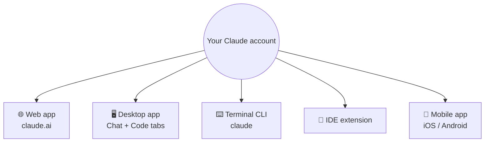
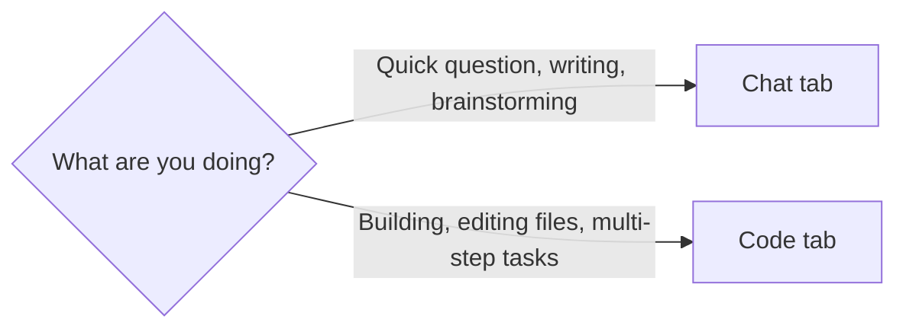

# 1. Where Claude Runs

Claude is one account available on several surfaces. Your chats, projects and settings sync between them.



## Which one should you use?

| Surface | Best for | Notes |
|---|---|---|
| **Desktop app** | Day-to-day work (recommended default) | Has both a *Chat* and a *Code* tab, integrated browser, file view, terminal |
| **Web** | Quick chats from any machine | Same core features as desktop chat |
| **Terminal (CLI)** | Developers who live in the shell | Richest feature set, scriptable |
| **IDE extension** | Working inside your editor | Same Claude Code engine |
| **Mobile** | Monitoring agents, quick questions, photos & voice on the go | Great for "capture now, continue later" |

**Recommendation:** install the desktop app *and* the mobile app. Use desktop for work, phone to check on long-running sessions.

## Installing

### Desktop
Download the installer for your OS from the Claude download page and sign in.

### Terminal
Use the install command from the official docs for your platform (there are separate commands for macOS/Linux and Windows PowerShell). After installing:

```bash
cd my-project
claude          # first run asks you to sign in
```

The first time you open a folder, Claude asks whether you trust it — answer yes for your own projects.

## Chat tab vs. Code tab (desktop)



The **Code** tab is the Claude Code environment: it works inside a project folder, can read/write files, run commands, and supports all the features in this course. Switch with the toggle in the top-right of the desktop app.

➡️ Next: [Plans and usage limits](02-plans-and-limits.md)
