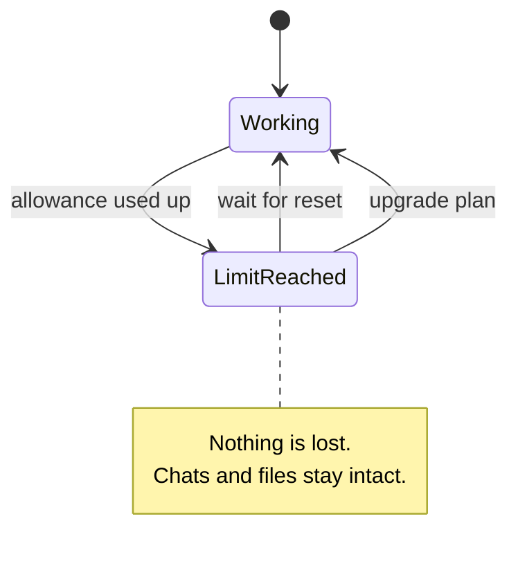
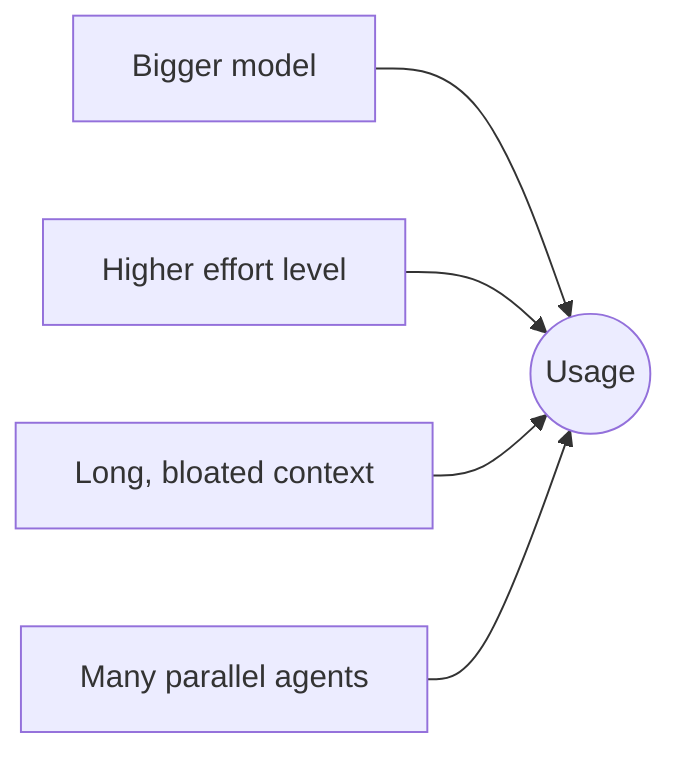

# 2. Plans and Usage Limits

## Plan tiers (as described in the videos)

| Plan | Claude Code access | Who it's for |
|---|---|---|
| Free | ❌ Chat only | Trying Claude out |
| Pro | ✅ Code tab + terminal | Anyone doing real work |
| Max 5× | ✅ | Heavy daily users |
| Max 20× | ✅ | Power users running long/parallel agents |

> Prices and exact limits change — check the pricing page before deciding.

## How limits work

Every plan has a usage allowance that **refills on a schedule**. Hitting it is not an error:

## What burns usage fastest

**Habits that save usage**

- *Same task, same chat. New topic, new chat.* One endless conversation is the most expensive way to work.
- Use a smaller model or lower effort for simple, repetitive tasks (see [Models](../01-core-concepts/02-models.md) and [Effort levels](../01-core-concepts/03-effort-levels.md)).
- Keep context lean with `/compact` and `/clear` (see [Context management](../04-daily-workflow/01-context-management.md)).

**Advice from the videos:** start on the free plan, upgrade the day you actually hit a wall.

➡️ Next: [Desktop UI tour](03-desktop-ui-tour.md)
