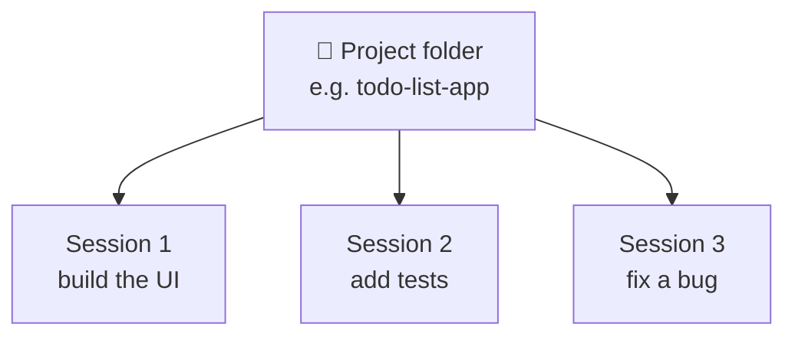

# 3. Desktop UI Tour (Code tab)

```text
┌──────────────┬─────────────────────────────────────────┬──────────────────┐
│ SIDEBAR      │  SESSION (chat with Claude)             │  TOP-RIGHT TOOLS │
│              │                                         │                  │
│ + New        │  > your prompt …                        │  ⌨ Terminal      │
│ Artifacts    │                                         │  ± Changed files │
│ Routines     │  Claude's work, tool calls, results     │  🌐 Browser      │
│ Customize    │                                         │  📁 Files        │
│              │                                         │  ⋯ Keep awake    │
│ Projects ▾   │ ┌─────────────────────────────────────┐ │                  │
│  └ sessions  │ │ 📁 folder | model | effort | mode   │ │                  │
│ ⚙ Settings   │ └─────────────────────────────────────┘ │                  │
└──────────────┴─────────────────────────────────────────┴──────────────────┘
```

## Key ideas

### Project = folder
The very first thing to do: **open a folder**. Claude writes files there and keeps project-specific history and memory for it.



- **Project** — a folder you work in. Appears in the sidebar after first use; archive it to hide it.
- **Session** — one conversation inside a project. Start a new one when you want a clean slate.
- You can attach *additional* folders as extra context.

### Top-right tools

| Tool | What it does |
|---|---|
| Terminal | Run commands yourself |
| Changed files | Diff view of what Claude changed (requires git) |
| Browser | Built-in browser Claude can drive — it starts a dev server and tests your app |
| Files | Browse the project tree |
| ⋯ menu | e.g. keep the computer awake while Claude works |

### Bottom bar of a session
- **Folder** — which project you're in
- **Model** — see [Models](../01-core-concepts/02-models.md)
- **Effort** — see [Effort levels](../01-core-concepts/03-effort-levels.md)
- **Mode** — see [Permission modes](../01-core-concepts/04-permission-modes.md)
- **Context/usage indicator** — see [Context management](../04-daily-workflow/01-context-management.md)

### Settings
Plan, usage limits, changelog, API keys.

✅ **Module complete.** Continue with [01 Core Concepts](../01-core-concepts/README.md).
