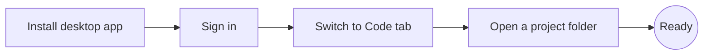

# Module 00 — Getting Started

**Goal:** have Claude installed, signed in, and a project folder open in the Code tab.

| # | Lesson | Time |
|---|---|---|
| 1 | [Where Claude runs](01-where-claude-runs.md) | 5 min |
| 2 | [Plans and usage limits](02-plans-and-limits.md) | 5 min |
| 3 | [Desktop UI tour](03-desktop-ui-tour.md) | 10 min |

**Checkpoint:** you can start a new session inside a folder you created for this course.

➡️ Practice: [Lab 01 — First project](../labs/lab-01-first-project.md)
