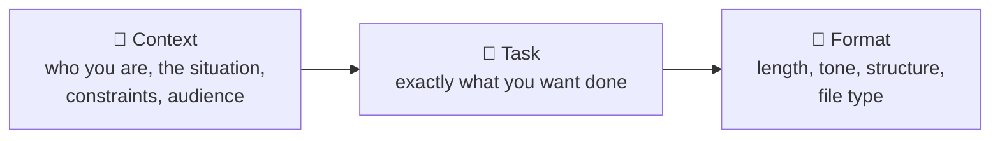
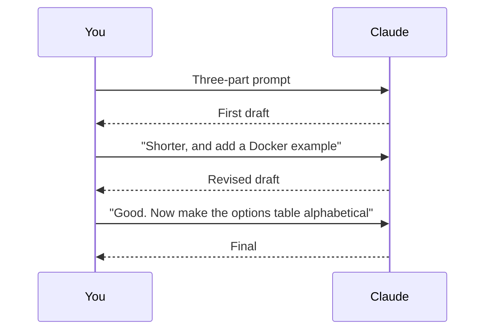

# 1. Prompting: Context, Task, Format

A prompt is simply the message you send. The gap between a vague prompt and a structured one is the gap between a generic answer and a useful one.

## The three-part prompt



### Example

❌ **Weak**
```text
Write a README for my project.
```

✅ **Strong**
```text
Context: This is a Python CLI that converts CAN log files (.asc) to Parquet.
Users are test engineers who know Python but not this tool.

Task: Write the README.

Format: Markdown. Sections: Overview, Install, Quickstart (one copy-paste
example), Options table, Troubleshooting. Under 150 lines. Neutral tone.
```

## Reply and refine

Claude keeps everything earlier in the session. Don't rewrite the whole prompt — steer:



## Tips specific to Claude Code

| Tip | Why |
|---|---|
| **Name your stack** ("use React + Vite, pnpm, no CSS framework") | Otherwise Claude picks one for you |
| **Ask Claude to interview you** ("ask me questions before planning") | Surfaces decisions you hadn't thought of |
| **Reference files with `@`** | Points Claude at exactly the right code (see [Referencing context](../02-project-context/04-referencing-context.md)) |
| **Use your voice** | Dictating long, detailed prompts is faster than typing |
| **Don't chase identical output** | The same prompt gives different results each time — that's normal |

➡️ Next: [Choosing a model](02-models.md)
