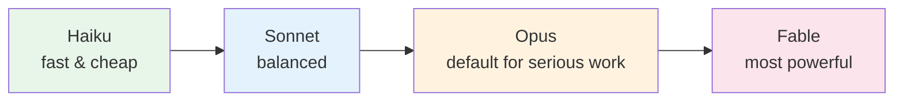
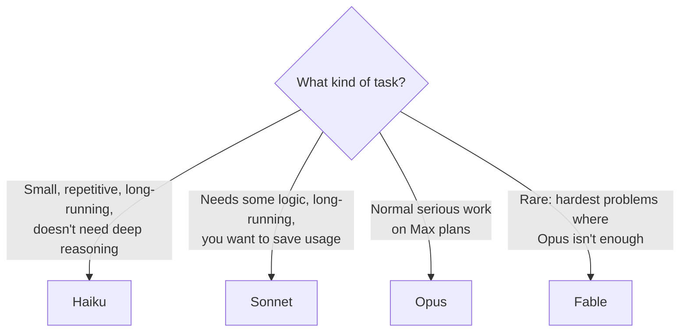

# 2. Choosing a Model

The model is the "brain" answering you. You can switch it at any time, even mid-session.

> Model lineup at the time of the videos (Oct 2026). Names and versions will change; the logic won't.

## Decision guide

| Model | Use it when | Usage cost |
|---|---|---|
| **Haiku** | Bulk renames, simple edits, repetitive steps | Lowest |
| **Sonnet** | Everyday work on lower plans; long tasks where you want to conserve usage | Medium |
| **Opus** | The default for most real work if your plan allows | Higher |
| **Fable** | Occasional, very demanding workflows | Highest |

**Rule of thumb:**
- On **Max** plans: leave it on Opus.
- On **Pro/Free**: default to Sonnet, drop to Haiku for simple stuff, step up to Opus when quality really matters.

> **Want to run open-weights or local models?** See [Module 07 — Running with Ollama](../07-running-with-ollama/README.md) to use models like Qwen, Llama, Kimi, and DeepSeek via Ollama's Anthropic-compatible API.

➡️ Next: [Effort levels](03-effort-levels.md)
