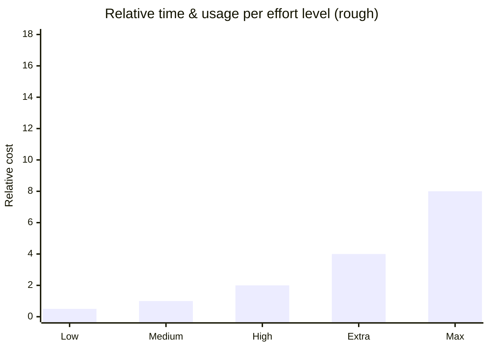
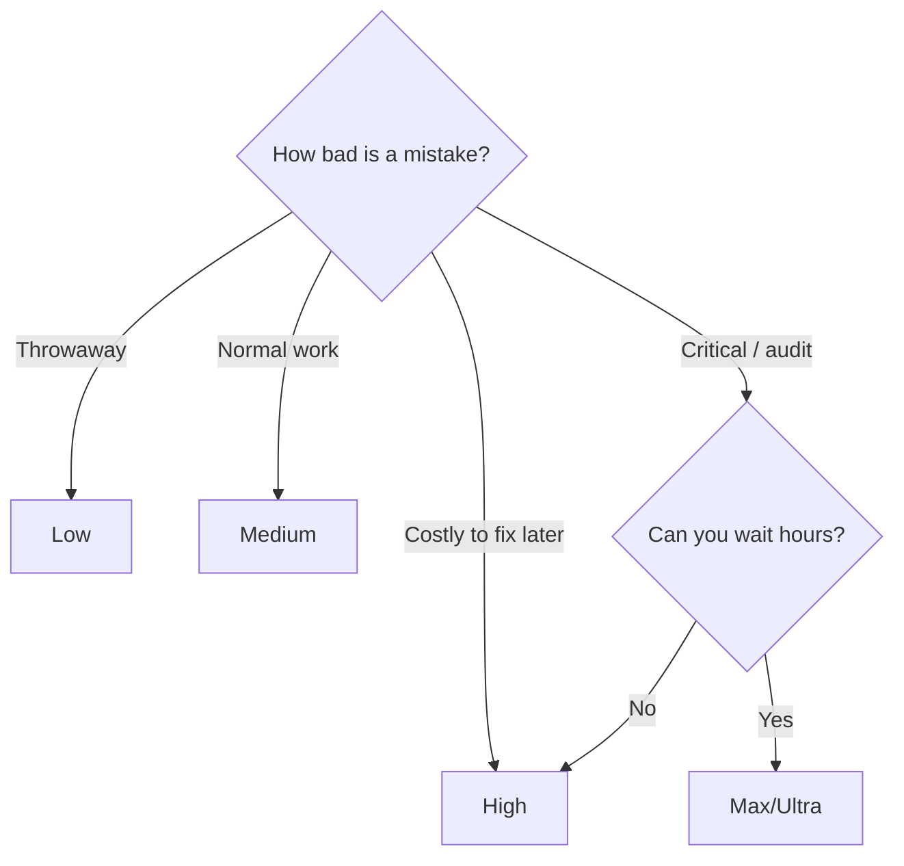

# 3. Effort Levels

Effort controls **how long Claude thinks and how much it checks its own work**. It is independent of the model.

> Rule of thumb from the videos: each step up roughly **doubles** time and usage for the same task.

| Level | Behavior | Use it for |
|---|---|---|
| **Low** | Acts immediately, barely checks | Quick prototypes, proofs of concept |
| **Medium** | A few self-checks, moderate thinking | ✅ Everyday default |
| **High** | Deeper reasoning and verification | Tricky features, important refactors |
| **Extra / Max** | Very thorough; can run for hours | Complex systems where correctness is critical |
| **Ultra** (Ultracode) | Massive thinking + checking; can run 6–7 h | Security audits, overnight jobs, "must be 100 % right" |

## Picking the level

**Practical advice:** stay on *medium*, go up only when you see the result isn't good enough. Higher effort is often overkill — the same outcome is frequently reachable with *high*.

➡️ Next: [Permission modes](04-permission-modes.md)
