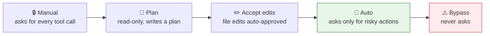
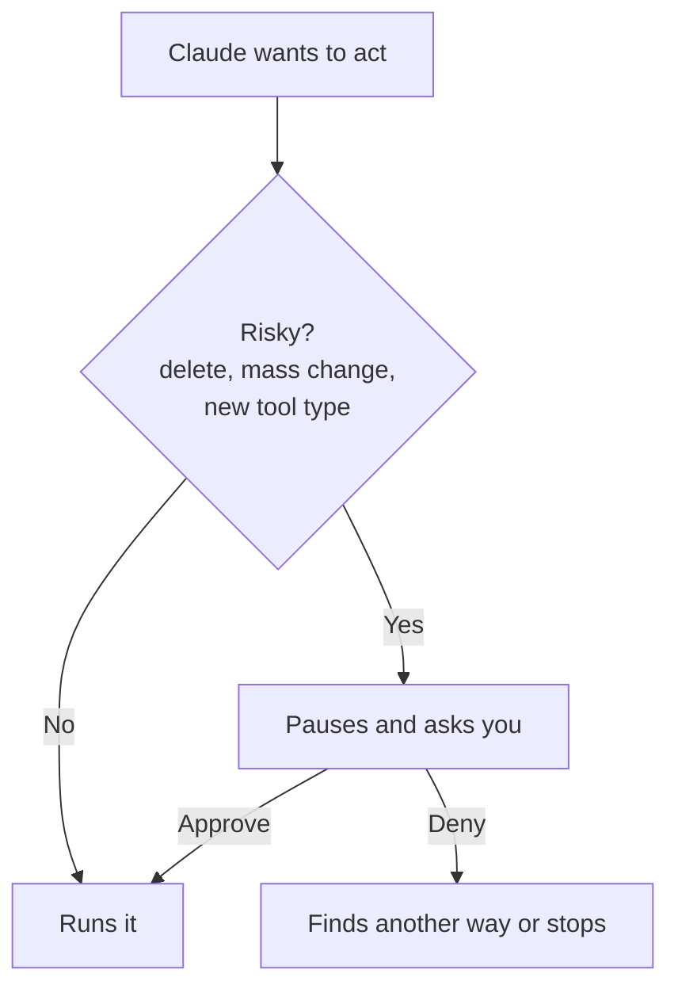

# 4. Permission Modes

The **mode** decides how much Claude may do without asking you.

| Mode | Asks before… | When to use |
|---|---|---|
| **Manual** | every tool call | Unfamiliar codebase, learning what Claude does |
| **Plan** | — (makes no changes) | Before any non-trivial build: think first |
| **Accept edits** | commands, but not file edits | You trust edits, want to watch commands |
| **Auto** *(default)* | destructive/unusual actions: deletes, mass changes, new kinds of tool calls | ✅ 90 % of the time |
| **Bypass permissions** | nothing | Sandboxed/throwaway environments only |

## How Auto mode decides

## Make it permanent per project
You can pre-approve or block specific commands for a project in `.claude/settings.json` → see [settings.json](../02-project-context/03-settings-json.md).

> ⚠️ Avoid **Bypass** on your real machine. Use **Auto** + **Plan** as your two everyday modes.

➡️ Next: [The plan-mode workflow](05-plan-mode-workflow.md)
