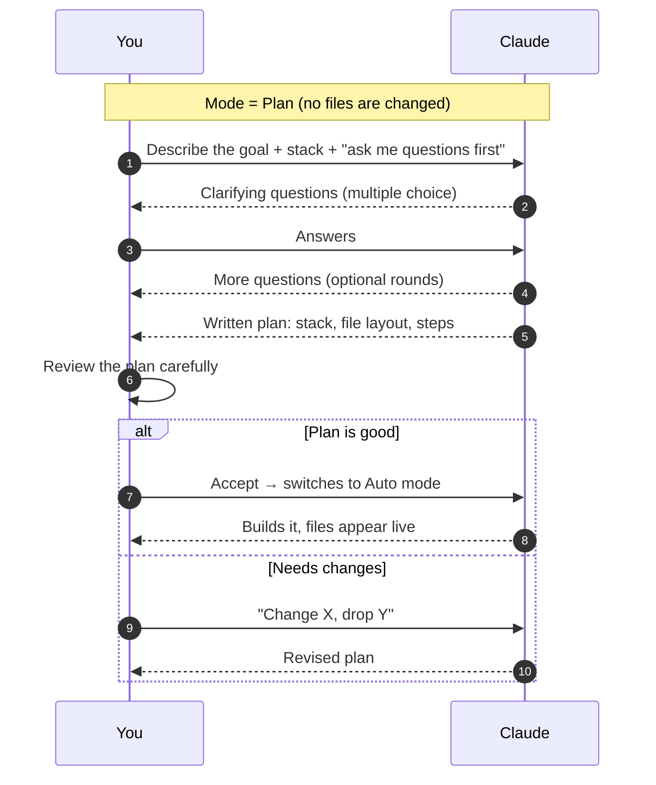

# 5. The Plan-Mode Workflow

The single most valuable habit when starting something new: **plan before building**.



## Before you prompt: decide your stack

Claude will choose for you if you don't. Write down:

- [ ] What you're building and for whom
- [ ] Language / framework / database
- [ ] Package manager, test framework
- [ ] Folder conventions ("keep it flat", "src/ only")
- [ ] Git? GitHub?

## A template plan-mode prompt

```text
I want to build <WHAT> for <WHO>.

Stack: <language, framework, db, package manager>.
Constraints: <performance, offline, no external APIs, etc.>.
Must-haves: <3–5 features>.
Nice-to-haves: <optional>.

Before writing a plan, ask me any questions you need to clarify scope,
design and trade-offs. Then produce a plan with: stack + dependencies,
folder layout, build steps, and how we'll test it.
```

## What to check in the plan

| Section | Ask yourself |
|---|---|
| Stack & dependencies | Exactly what I wanted? Nothing unnecessary? |
| File layout | Will I understand this structure in a month? |
| Steps | Is the order sensible? Are tests included? |
| Assumptions | Anything Claude guessed that I should correct? |

> Reading the plan for 3 minutes saves hours of re-work. In the video, Claude's questions surfaced features the author hadn't thought of (labels, traffic, lighting).

✅ **Module complete.** Continue with [02 Project Context](../02-project-context/README.md).
