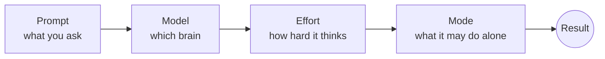

# Module 01 — Core Concepts

**Goal:** control *how* Claude works — what you ask, which brain answers, how hard it thinks, and how much it may do without asking.

| # | Lesson | Time |
|---|---|---|
| 1 | [Prompting: context, task, format](01-prompting.md) | 10 min |
| 2 | [Choosing a model](02-models.md) | 5 min |
| 3 | [Effort levels](03-effort-levels.md) | 5 min |
| 4 | [Permission modes](04-permission-modes.md) | 10 min |
| 5 | [The plan-mode workflow](05-plan-mode-workflow.md) | 15 min |
| 6 | [Claude 101: API & Prompt Engineering](06-claude-101-api-fundamentals.md) | Deep Dive |
| 7 | [AI Fluency Framework: Foundations](07-ai-fluency-framework.md) | Deep Dive |

➡️ Practice: [Lab 02 — Plan mode](../labs/lab-02-plan-mode.md)
