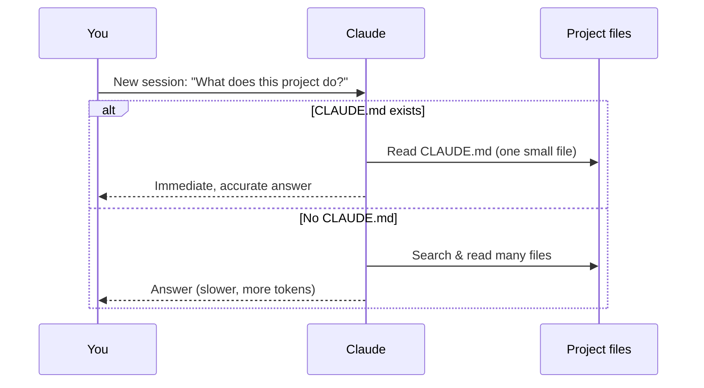
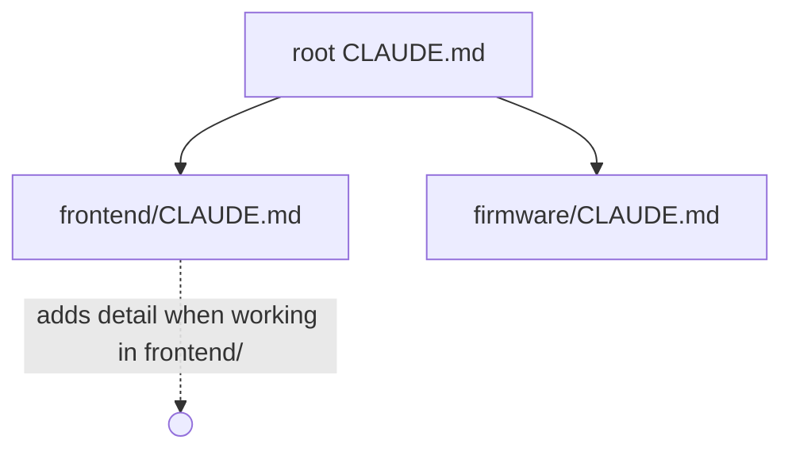

# 1. CLAUDE.md — The Project's Standing Instructions

`CLAUDE.md` is a Markdown file Claude **reads automatically at the start of every session**. It's where you put everything Claude should never forget: what the project is, how to run it, the architecture, and your rules.



## Create it with `/init`

```text
/init
```

Claude scans the project and writes a `CLAUDE.md` in the root. You can add guidance after the command:

```text
/init Focus on build/test commands and our naming conventions.
```

## What belongs in it

| Section | Example content |
|---|---|
| Overview | One paragraph: what it is, who uses it |
| Commands | `npm run dev`, `npm test`, `npm run lint` |
| Architecture | Key folders and how data flows |
| Conventions | Naming, formatting, error handling, commit style |
| Rules / don'ts | "Never edit `public/data/`", "No new dependencies without asking" |
| Gotchas | Known quirks, flaky tests, env setup |

See a full example: [`examples/starter-project/CLAUDE.md`](https://github.com/CagriCatik/claude-ollama-coder/tree/main/examples/starter-project/CLAUDE.md)

## Keep it short and true
- It's loaded into **every** session → every line costs context. Aim for < 200 lines.
- Bullet points beat prose.
- Update it when things change — or ask Claude: *"update CLAUDE.md with what we just decided"*.

## Nested CLAUDE.md files

You can add more `CLAUDE.md` files in subfolders for sub-projects:

```text
my-app/
├── CLAUDE.md          ← general project rules
├── frontend/
│   └── CLAUDE.md      ← React-specific rules
└── firmware/
    └── CLAUDE.md      ← embedded C rules
```



Instructions closer to where you're working add more specific guidance on top of the general file. Useful in monorepos; unnecessary for small projects.

➡️ Next: [Memory](02-memory.md)
