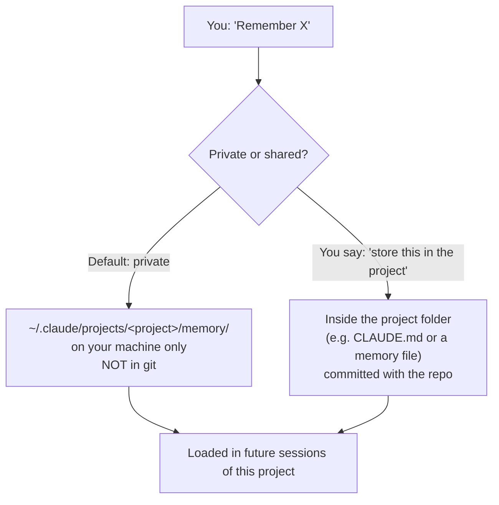

# 2. Memory

To make Claude remember something, just say so:

```text
Remember that our CI runs on Python 3.11 and we deploy every Thursday.
```

## Where it goes



| Kind | Location | Who sees it | Use for |
|---|---|---|---|
| **Private memory** | Your user `.claude` directory, per project | Only you, on this machine | Your name, personal preferences, local paths |
| **Project memory** | Inside the repo (`CLAUDE.md` or a memory file) | Everyone who clones | Team decisions, conventions |

> The video's surprise moment: Claude said "remembered", but no file appeared in the project — because the default memory is stored **outside** the repo. Ask explicitly if you want it in the project.

## Memory vs. CLAUDE.md

| | CLAUDE.md | Memory |
|---|---|---|
| Written by | You (or Claude via `/init`) | Claude, when you ask it to remember |
| Purpose | Rules and project description | Facts and preferences picked up along the way |
| Shared | Yes (in repo) | Private by default |

## Chat app memory (claude.ai)
The regular Claude app also has memory: it learns from your chats, you can edit it in **Settings → Memory**, import memory from other assistants, and use **incognito chats** that don't read or write memory. See [Projects & memory](../05-beyond-code/01-projects-and-memory.md).

➡️ Next: [settings.json](03-settings-json.md)
