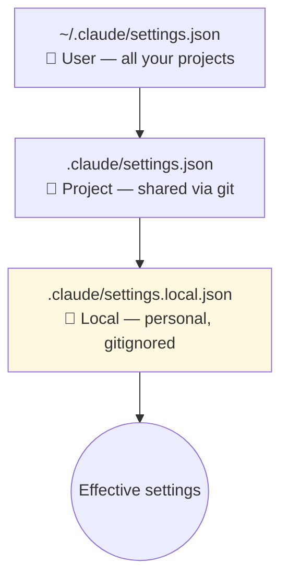
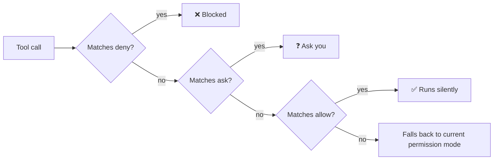

# 3. `.claude/settings.json`

Project-level configuration for Claude Code. It controls **what Claude may do without asking** and tweaks how Claude Code behaves in this repo. Because it's committed, everyone on the team gets the same rules.

## Settings hierarchy



More specific levels override broader ones.

## Permissions: allow / ask / deny

```json
{
  "permissions": {
    "allow": [
      "Bash(npm run dev)",
      "Bash(npm run build)",
      "Bash(npm test:*)",
      "Edit(src/**)"
    ],
    "ask": [
      "Bash(npm install:*)"
    ],
    "deny": [
      "Read(.env)",
      "Read(.env.*)",
      "Edit(public/data/**)"
    ]
  }
}
```



| List | Meaning | Typical entries |
|---|---|---|
| `allow` | Never ask | Dev server, build, tests, edits in `src/` |
| `ask` | Always ask | Installing packages, git push |
| `deny` | Never allowed | Secrets (`.env`), generated or protected data |

## Other things you can put here
- **Hooks** — commands that run on events (see [Hooks](../03-extending-claude/04-hooks.md))
- **Spinner verbs** — custom words shown while Claude is thinking (the video used Toronto-themed ones 😄)
- Environment variables, model defaults, and more — see the official settings docs.

## Related: `.claude/launch.json`
Claude creates this automatically the first time it figures out how to start your app, so the built-in browser can launch it next time without re-discovering.

## Don't hand-write it
Ask Claude:
```text
Create .claude/settings.json: allow running dev/build/test without asking,
always ask before installing packages, never read .env files.
```

Full example: [`examples/starter-project/.claude/settings.json`](https://github.com/CagriCatik/claude-ollama-coder/tree/main/examples/starter-project/.claude/settings.json)

➡️ Next: [Referencing context](04-referencing-context.md)
