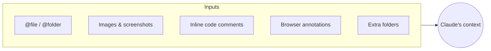
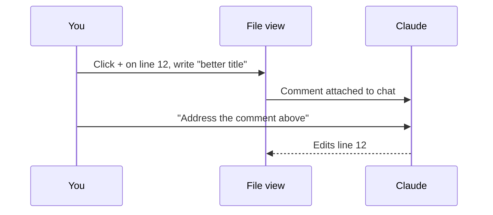

# 4. Referencing Files, Images & Comments

Precise context beats long explanations. Claude Code gives you several ways to point at exactly what you mean.

| Method | How | Example |
|---|---|---|
| **@-mention** | Type `@` and pick a file, folder or even another session | `Refactor @src/api/client.ts to use fetch` |
| **Images** | Paste or drag screenshots, diagrams, photos | "Make the UI match this mockup" |
| **Inline comment** | In the file view, click **+** on a line and write a comment, then tell Claude *"address the comment above"* | "rename this title" on `index.html:12` |
| **Browser select / draw** | In the built-in browser, select an element or switch to draw mode and circle something | "This button is misaligned" |
| **Extra folders** | Attach another folder to the session as read context | Shared lib, docs repo |

## Workflow: comment-driven edits

✅ **Module complete.** Continue with [03 Extending Claude](../03-extending-claude/README.md).
