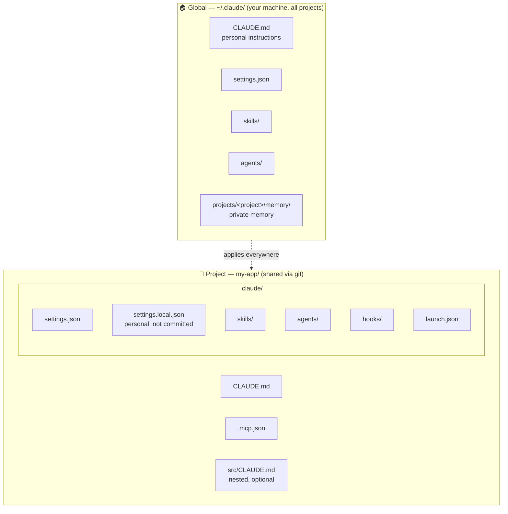

# Module 02 — Project Context

**Goal:** teach Claude your project once, so every new session starts informed instead of re-exploring the codebase.

| # | Lesson | Time |
|---|---|---|
| 1 | [CLAUDE.md](01-claude-md.md) | 15 min |
| 2 | [Memory](02-memory.md) | 10 min |
| 3 | [settings.json](03-settings-json.md) | 15 min |
| 4 | [Referencing files, images & comments](04-referencing-context.md) | 10 min |

## Where everything lives

**Global vs. project** is the most important distinction in this module and the next one: almost everything (instructions, skills, subagents, hooks, settings) can live *globally* (just for you, everywhere) or *in the project* (for everyone who clones it).

➡️ Practice: [Lab 03 — CLAUDE.md](../labs/lab-03-claude-md.md) and [Lab 04 — settings.json](../labs/lab-04-settings.md)
