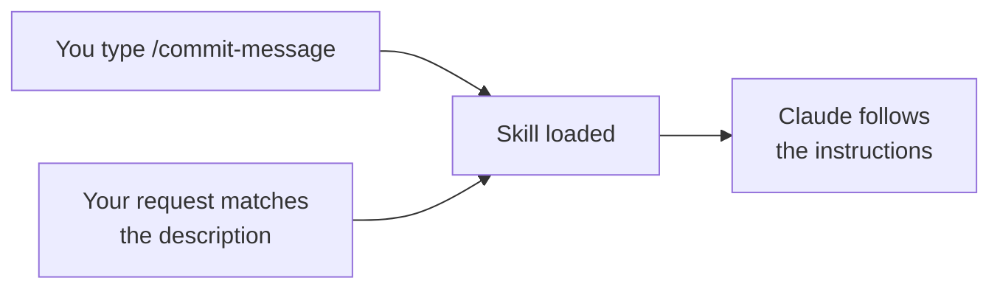
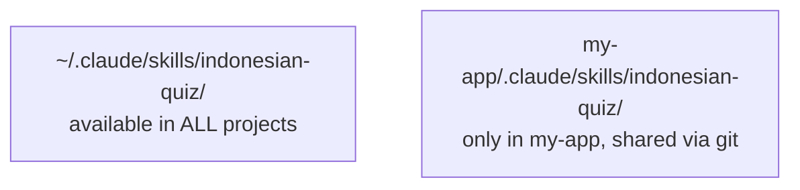

# 1. Skills

A **skill** is a Markdown file of reusable instructions — a recipe card for Claude. Install once, use in any session.

**Signal you need one:** you've explained the same multi-step procedure to Claude more than twice.

## Anatomy

```text
.claude/skills/
└── commit-message/
    ├── SKILL.md          ← required: frontmatter + instructions
    ├── examples.md       ← optional supporting files
    └── scripts/
        └── check.sh      ← optional scripts the skill can run
```

```markdown
---
name: commit-message
description: Write a Conventional Commits message from the staged diff. Use when the user asks for a commit message or to commit.
---

# Commit message

1. Run `git diff --staged`.
2. Pick a type: feat, fix, refactor, docs, test, chore.
3. Subject ≤ 72 chars, imperative mood, no period.
4. Body: what changed and why, wrapped at 72.
5. Output only the message in a code block.
```

The **description** matters most: it's how Claude decides when to use the skill automatically.

## How skills are used



## Global vs. project



The video demo: a quiz skill created globally worked everywhere; after moving it into a project's `.claude/skills/`, `/` no longer listed it in other projects.

## Getting skills

| Source | How |
|---|---|
| **Write one** | Ask Claude: *"Make a skill that … Save it to this project."* |
| **Built-in** | Anthropic ships several (e.g. frontend design, documents) |
| **Marketplace / directory** | Browse with `/skills` (Code) or *Customize → Skills* (app) |

## Good skill ideas
- Release notes from merged PRs
- Your team's code-review checklist
- "Explain this test failure" procedure
- Report or outline in *your* voice and structure
- Document styling / theming

Example: [`examples/starter-project/.claude/skills/commit-message/SKILL.md`](https://github.com/CagriCatik/claude-ollama-coder/tree/main/examples/starter-project/.claude/skills/commit-message/SKILL.md)

➡️ Next: [Subagents](02-subagents.md)
