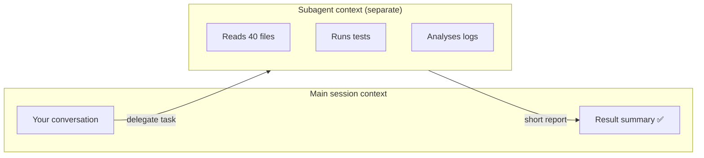
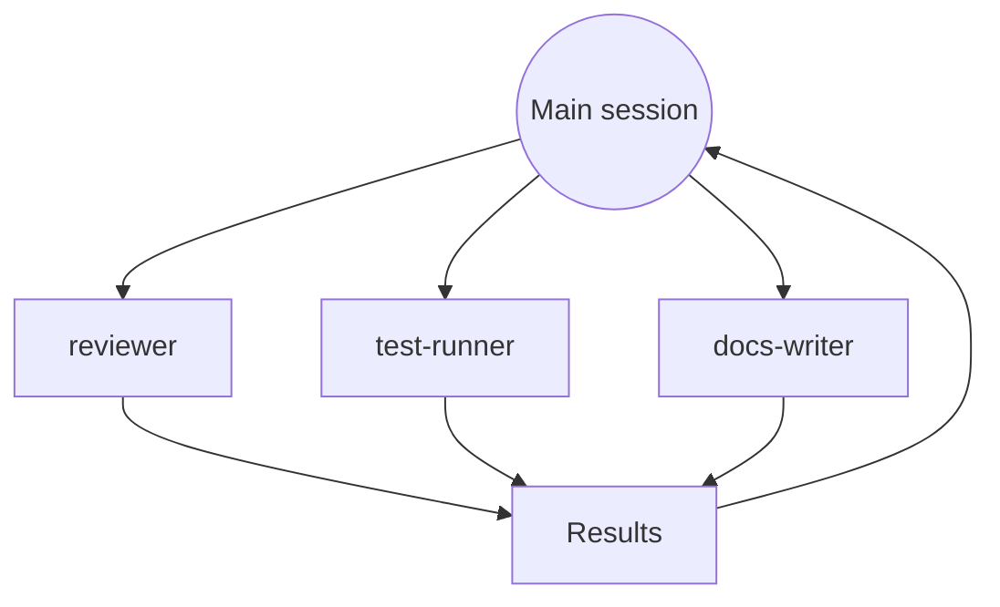

# 2. Subagents

A **subagent** is a customized Claude worker you delegate tasks to. It runs in **its own context window**, in the background, and reports back only the result.

## Why: protect the main context



Without a subagent, all of that reading and tool output would fill your main session.

## Parallel subagents



## Definition file

```text
.claude/agents/code-reviewer.md     ← project
~/.claude/agents/code-reviewer.md   ← global
```

```markdown
---
name: code-reviewer
description: Reviews recent changes for bugs, security issues and convention violations. Use after a feature is implemented.
tools: Read, Grep, Glob, Bash
model: sonnet
---

You are a senior reviewer. Review only the current diff (`git diff`).
Report: 🔴 must-fix, 🟡 should-fix, 🟢 nitpicks — each with file:line.
Never edit files.
```

| Field | Purpose |
|---|---|
| `name` | How you refer to it |
| `description` | When Claude should delegate to it |
| `tools` | Restrict what it may do (e.g. read-only reviewer) |
| `model` | Run cheaper tasks on a smaller model |
| (body) | The subagent's system instructions |

## Using it

```text
Use the code-reviewer subagent on my last changes.
Run 3 subagents in parallel: one per service, each checking for unused config keys.
```

- Create one by asking Claude (*"create a project subagent that …"*). The old `/agents` wizard was removed in the version shown.
- If a newly created subagent isn't picked up, start a new session.
- Click a running agent to see its prompt and tool calls; ask Claude to *"list agents"* to see what's available.

Example: [`examples/starter-project/.claude/agents/code-reviewer.md`](https://github.com/CagriCatik/claude-ollama-coder/tree/main/examples/starter-project/.claude/agents/code-reviewer.md)

➡️ Next: [MCP servers](03-mcp.md)
