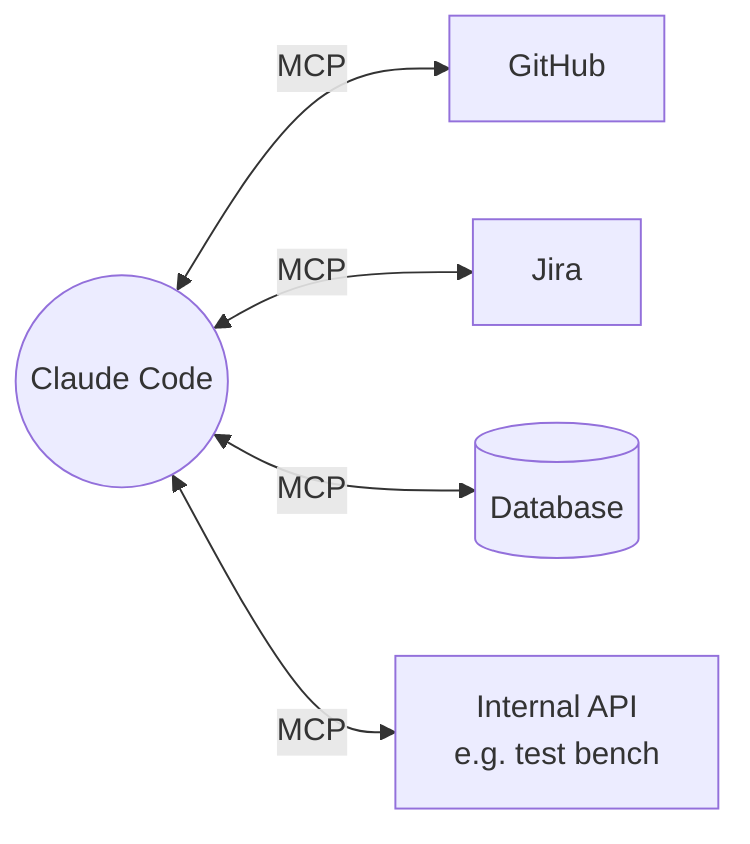

# 3. MCP Servers

**MCP (Model Context Protocol)** is the standard way to plug external tools and data sources into Claude: GitHub, Jira, databases, calendars, email platforms, your own internal APIs.



An MCP server exposes **tools** (actions Claude can call) and sometimes **resources** (data it can read).

## Managing servers

```text
/mcp                 # view, connect, authenticate servers
```

Or from the terminal:

```bash
claude mcp add <name> -- <command to start a local server>
claude mcp add --transport http <name> https://example.com/mcp
claude mcp list
```

Or simply ask: *"Add the GitHub MCP server to this project."*

## Sharing with the team: `.mcp.json`

```json
{
  "mcpServers": {
    "github": {
      "type": "http",
      "url": "https://api.githubcopilot.com/mcp/"
    },
    "local-db": {
      "command": "npx",
      "args": ["-y", "@example/db-mcp", "--readonly"]
    }
  }
}
```

## Connectors (claude.ai app)
In the chat app, MCP servers appear as **connectors** (*Customize → Connectors*). Popular ones (Google Drive, Calendar, Slack, …) are one click; anything else can be added as a **custom connector** with a server URL. See [Connectors](../05-beyond-code/02-connectors.md).

## Safety
- Claude asks before using a connected tool; you can *always allow* trusted read-only actions.
- Prefer read-only scopes for databases and production systems.
- Each server adds tool descriptions to context — disconnect ones you don't use.

➡️ Next: [Hooks](04-hooks.md)
