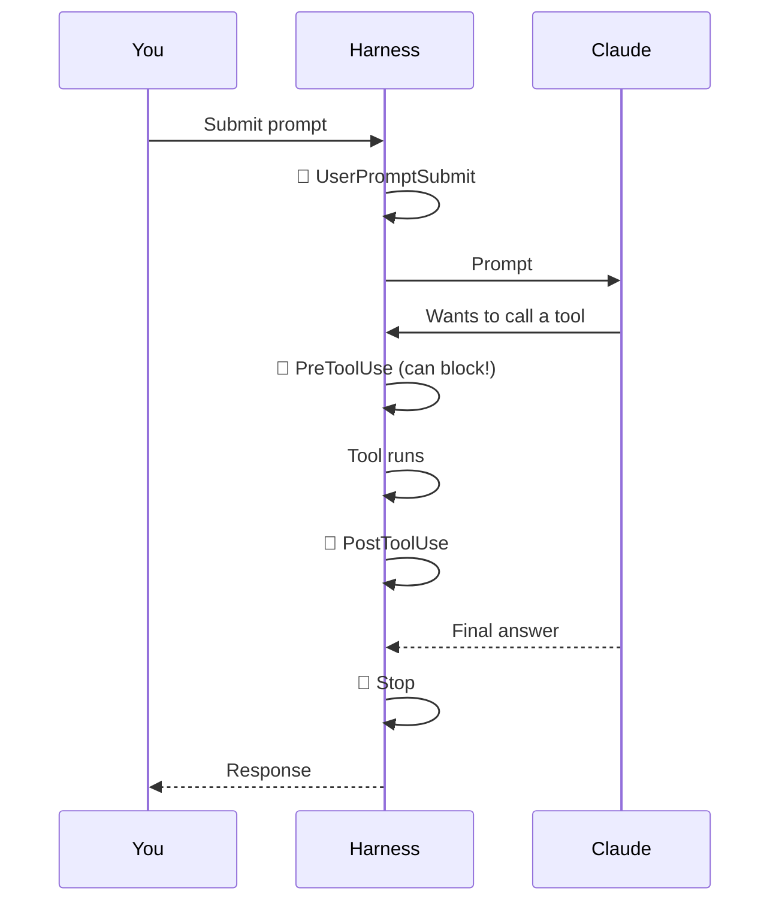

# 4. Hooks

A **hook** is a shell command that Claude Code (the harness) runs **automatically when an event happens**. Claude doesn't decide to run it — it fires every time.

> Skills are *suggestions Claude follows*. Hooks are *guarantees*.

## Event lifecycle (main events)



There are 30+ events in total (session start/end, subagent stop, notifications, compaction, …).

## Each hook has three parts

| Part | Example |
|---|---|
| **Event** | `PostToolUse` |
| **Matcher** (optional filter) | `Edit|Write` |
| **Command** | `npx prettier --write "$FILE"` |

## Configuration (in `settings.json`)

```json
{
  "hooks": {
    "Stop": [
      {
        "hooks": [
          { "type": "command", "command": ".claude/hooks/notify.sh" }
        ]
      }
    ],
    "PostToolUse": [
      {
        "matcher": "Edit|Write",
        "hooks": [
          { "type": "command", "command": "npm run lint --silent" }
        ]
      }
    ],
    "PreToolUse": [
      {
        "matcher": "Read|Edit",
        "hooks": [
          { "type": "command", "command": ".claude/hooks/block-secrets.sh" }
        ]
      }
    ]
  }
}
```

## Useful hook ideas

| Event | Hook |
|---|---|
| `Stop` | Desktop notification "Claude is done" (the video's demo) |
| `PostToolUse` on edits | Auto-format / lint changed files |
| `PreToolUse` | Block reading `.env` or writing to protected paths |
| `Stop` | Run the test suite after every turn |
| `UserPromptSubmit` | Inject today's ticket or branch name as context |

> ⚠️ Hooks run with your user's permissions. Review hook scripts in repos you clone, just like any other script.

Example scripts: [`examples/starter-project/.claude/hooks/`](https://github.com/CagriCatik/claude-ollama-coder/tree/main/examples/starter-project/.claude/hooks/)

➡️ Next: [Plugins & mods](05-plugins-and-mods.md)
