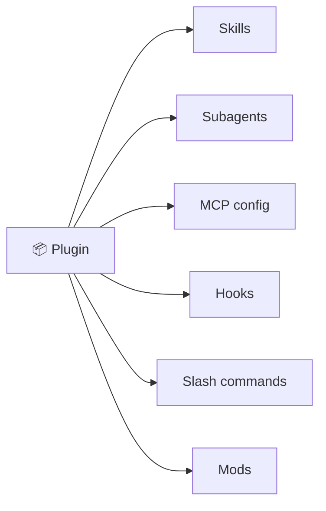
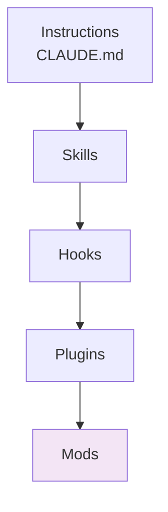

# 5. Plugins & Mods

## Plugins — bundles

A **plugin** packages several extensions so they install together.



```text
/plugins            # browse, install, enable/disable
```

Example: Anthropic's *frontend-design* plugin contains just one skill (`/frontend-design`), but a plugin can carry a team's entire setup — review agent, lint hooks, Jira MCP, and release-notes skill in one install.

**When to make one:** you want to give your whole team (or several of your own projects) the same configuration without copying `.claude/` folders around.

## Mods — customizing Claude Code itself

**Mods** are the newest layer (very new at the time of the video). A mod ships *inside a plugin* and customizes the Claude Code harness/UI, not just Claude's behavior.

| A hook can… | A mod can additionally… |
|---|---|
| Run a shell command on an event | Run a function inside Claude Code |
| | Add a live panel or pane beside the chat |
| | Add a status band / status line |
| | Show toasts, add slash commands, reload things |



*Customization depth increases downward.* Most people never need mods — but it's good to know they exist.

✅ **Module complete.** Continue with [04 Daily Workflow](../04-daily-workflow/README.md).
