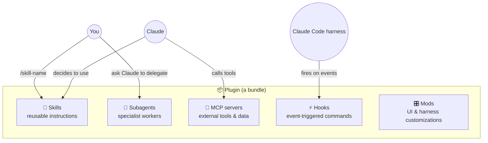

# Module 03 — Extending Claude

**Goal:** turn Claude into *your* tool with reusable instructions, specialist helpers, external connections and automatic behaviors.

| # | Lesson | Time |
|---|---|---|
| 1 | [Skills](01-skills.md) | 15 min |
| 2 | [Subagents](02-subagents.md) | 15 min |
| 3 | [MCP servers](03-mcp.md) | 10 min |
| 4 | [Hooks](04-hooks.md) | 15 min |
| 5 | [Plugins & mods](05-plugins-and-mods.md) | 10 min |
| 6 | [Model Context Protocol (MCP) Expert Guide](06-mcp-expert-guide.md) | Deep Dive |
| 7 | [Advanced MCP Patterns & Production](07-mcp-advanced-patterns.md) | Deep Dive |
| 8 | [Agent Skills: Extending Agent Capabilities](08-agent-skills-guide.md) | Deep Dive |
| 9 | [Subagents: Delegation & Coordination Architecture](09-subagents-architecture.md) | Deep Dive |
| 10 | [Claude Code Skills Deep Dive & Marketplace](10-skills-deep-dive.md) | Deep Dive |

## How the pieces relate

## Which extension do I need?

| You notice… | Use |
|---|---|
| "I keep explaining the same steps" | **Skill** |
| "This side task floods my context" / "I want a dedicated reviewer" | **Subagent** |
| "Claude can't reach my tool/data (GitHub, Jira, DB…)" | **MCP server** |
| "Something must happen *every time* X happens" | **Hook** |
| "I want to share a whole setup with my team" | **Plugin** |
| "I want a custom panel/status line in Claude Code itself" | **Mod** |

> **Global or project?** Every one of these can be installed for just you (`~/.claude/…`) or committed with the project (`.claude/…`).

➡️ Practice: [Lab 05 — Skill](../labs/lab-05-skill.md), [Lab 06 — Subagent](../labs/lab-06-subagent.md), [Lab 07 — Hook](../labs/lab-07-hook.md)
