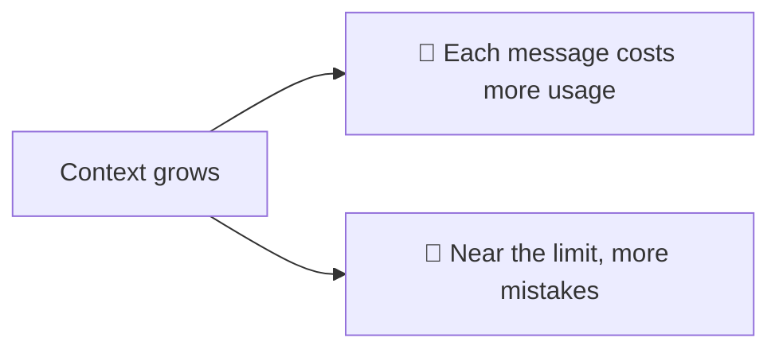
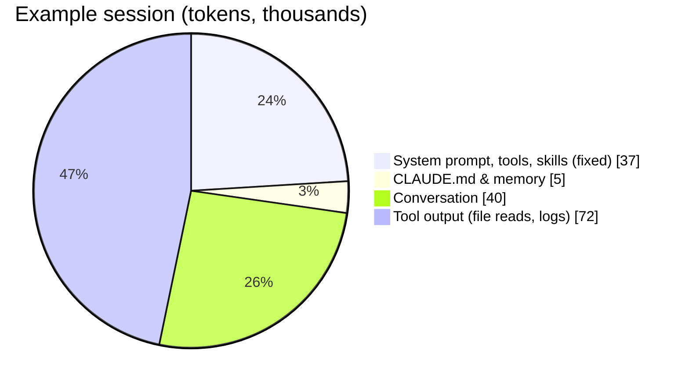
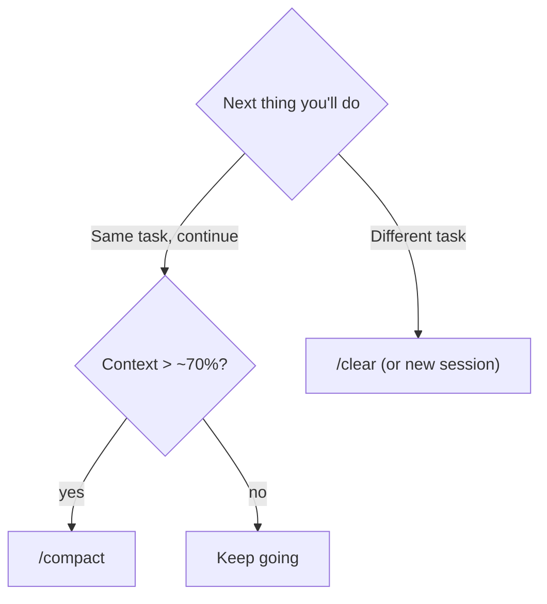

# 1. Context Management

The **context window** is everything Claude currently "sees": system prompt, tools, skills, `CLAUDE.md`, and the whole conversation including tool output. It's measured in tokens (the version shown had a 1M-token window).

## Why it matters

Every message re-sends the context, so a bloated session is both **expensive** and **less accurate**.

## What fills it

Click the context indicator at the bottom of the session (or run `/context`) for a detailed breakdown.

## The three commands

| Command | Effect | When |
|---|---|---|
| `/context` | Show usage % and breakdown | Anytime you're curious |
| `/compact` | Summarize the conversation, replace history with the summary | Long session, same task, getting heavy |
| `/clear` | Wipe the conversation, start fresh in the same window | Switching to an unrelated task |

> Claude auto-compacts near the limit, so `/compact` is optional — but doing it yourself at a natural break gives a better summary.
> In the video, `/clear` dropped the session to ~37k tokens: that's the fixed baseline from tools and skills.

## Habits
- **One task per session.** New topic → `/clear` or a new session.
- **Use subagents** for exploration-heavy side tasks ([Subagents](../03-extending-claude/02-subagents.md)).
- **Keep `CLAUDE.md` lean** — it's in every session.
- **Disconnect unused MCP servers** — their tool descriptions cost tokens.
- `/usage` shows your plan's usage limits.

➡️ Next: [Rewind](02-rewind.md)
