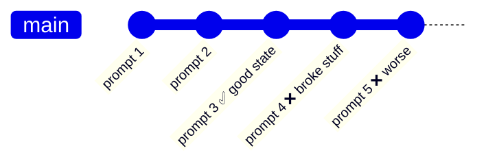

# 2. Rewind & Prompt History

## `/rewind` — checkpoints for conversation *and* code

Claude Code tracks the changes it makes at each step. `/rewind` lets you jump back to any earlier point.

Pick "prompt 3" in `/rewind` and choose what to restore:

| Option | Restores |
|---|---|
| Conversation only | Chat history; files stay as they are |
| Code only | Files; chat continues |
| Both | Everything back to that point |

Changes are stashed, so you can **undo a rewind** too.

> Rewind is a safety net, not a replacement for git. Commit good states regularly.

## Prompt history
Press **↑ / ↓** in the input box to cycle through prompts you've already sent — handy for re-sending or recovering a prompt after `/clear`.

➡️ Next: [Parallel sessions & worktrees](03-parallel-sessions-worktrees.md)
