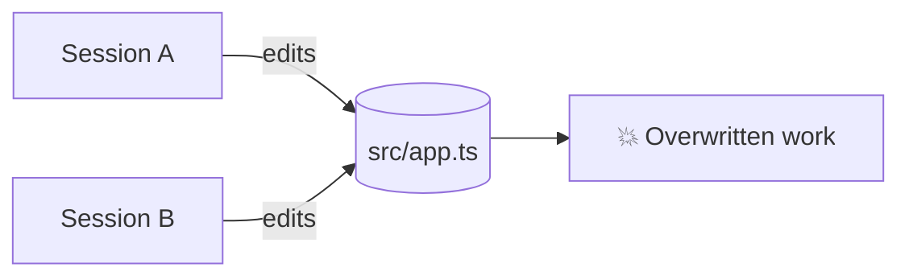
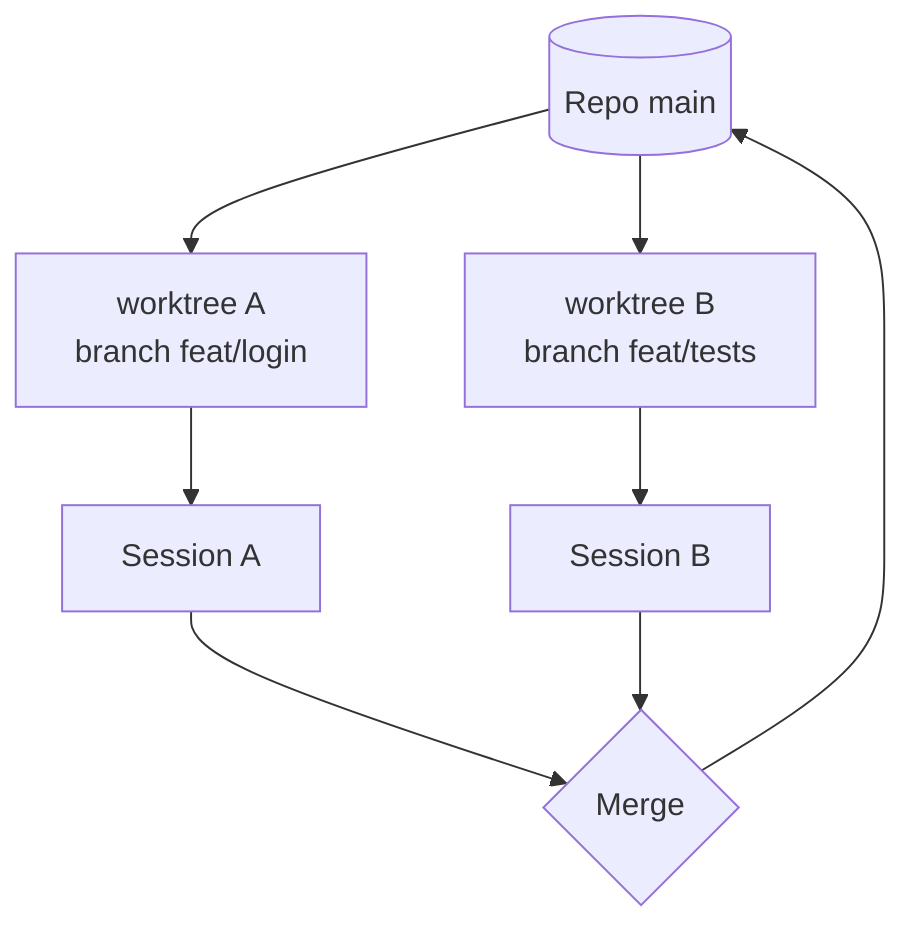
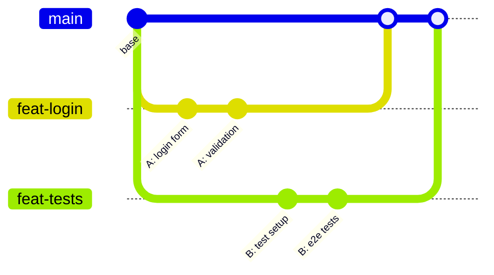

# 3. Parallel Sessions & Worktrees

You can run several sessions in the same project at once — e.g. one builds a feature while another writes tests. The sidebar shows progress for each; you can **split panes** to watch them side by side.

## The problem

## The fix: git worktrees

A **worktree** is a separate checkout of the repo on its own branch. Each session works in its own copy.

## Key facts

| Fact | Detail |
|---|---|
| Off by default (desktop) | Enable worktrees when starting a new session |
| Requires git | The project must be a git repository |
| Prevents | Sessions overwriting each other's files |
| Doesn't prevent | Merge conflicts when branches are combined |

## When to parallelize

✅ Independent work: frontend vs. backend, feature vs. docs, several bug fixes in different modules.
❌ Two sessions refactoring the same module — do it sequentially.

> Terminal users can do the same with `git worktree add ../my-app-feature feat/x` and run `claude` in each folder.

➡️ Next: [Code review](04-code-review.md)
