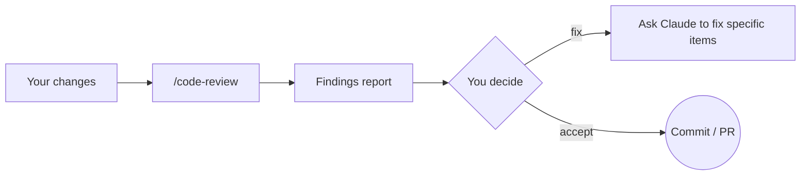

# 4. Code Review

```text
/code-review
/code-review focus on error handling in the new API client
```

Claude reviews your current changes (or a PR/issue in a connected git repo) **without modifying anything**, and reports findings.



## Make reviews better
- Add a **review checklist** to `CLAUDE.md` or a skill (security, logging, naming, tests).
- For deeper, isolated reviews, use a **reviewer subagent** with read-only tools ([example](https://github.com/CagriCatik/claude-ollama-coder/tree/main/examples/starter-project/.claude/agents/code-reviewer.md)).
- Run review at **high effort** for risky changes.

➡️ Next: [Routines](05-routines.md)
