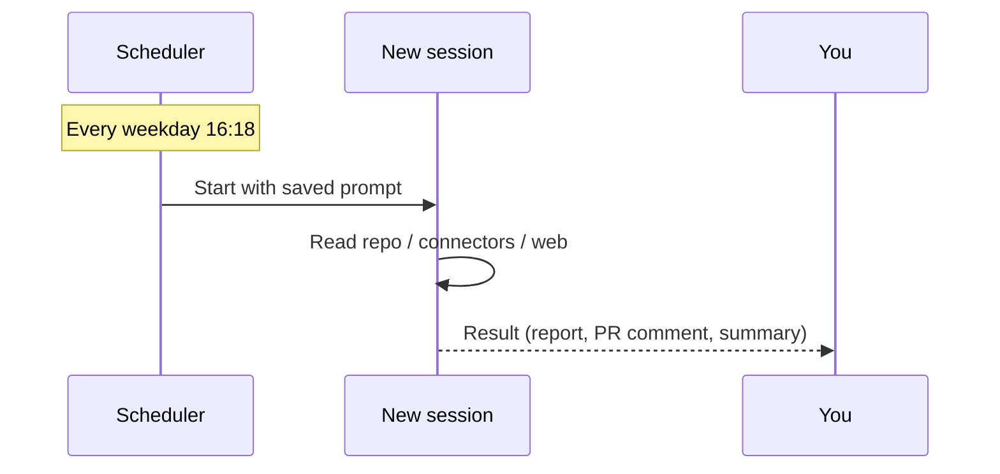

# 5. Routines (Scheduled Tasks)

A **routine** is a prompt that runs automatically on a schedule, spinning up a fresh session each time.



## Examples
- PR review of everything opened today
- Release notes draft every Friday
- System / dependency health check
- Daily briefing or email triage
- Weekly research report on a topic

## Creating one
Via the sidebar (**Routines**) or simply ask:

```text
Create a routine that runs every weekday at 08:30: summarize new commits
on main since yesterday and list any failing CI runs.
```

## Local vs. cloud

| | Local | Cloud |
|---|---|---|
| Runs on | Your computer | Anthropic's cloud |
| Needs | Computer on, app running | Nothing |
| Can access | Local files | Connected repos & connectors |

## Permissions for unattended runs
A routine running at 6 a.m. can't wait for you to approve each step. Review the routine's permission setting: start manual, watch the first run, then switch to automatic approval once you trust it.

✅ **Module complete.** Continue with [05 Beyond Code](../05-beyond-code/README.md).
