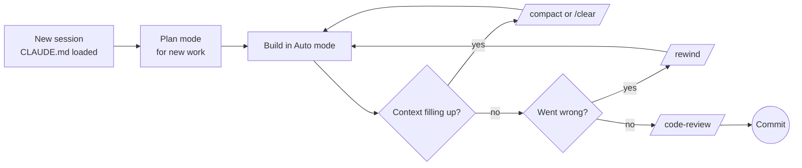

# Module 04 — Daily Workflow

**Goal:** work fast and safely every day — keep context healthy, undo mistakes, run work in parallel, review and automate.

| # | Lesson | Time |
|---|---|---|
| 1 | [Context management](01-context-management.md) | 15 min |
| 2 | [Rewind & prompt history](02-rewind.md) | 5 min |
| 3 | [Parallel sessions & worktrees](03-parallel-sessions-worktrees.md) | 15 min |
| 4 | [Code review](04-code-review.md) | 5 min |
| 5 | [Routines (scheduled tasks)](05-routines.md) | 10 min |
| 6 | [Claude Code in Action: Complete Guide](06-claude-code-in-action.md) | Deep Dive |

## A typical day

➡️ Practice: [Lab 08 — Parallel work](../labs/lab-08-parallel.md)
