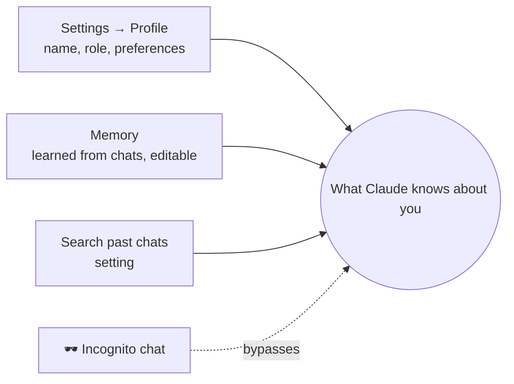

# 1. Projects & Memory in the Claude App

The chat app has its own equivalents of `CLAUDE.md` and memory.

## Projects

A **project** is a workspace that groups chats and gives them shared context.

```mermaid
flowchart TB
    P[📂 Project: "Test bench docs"]
    P --> K[📚 Knowledge<br/>uploaded files every chat can use]
    P --> I[📝 Instructions<br/>tone, audience, rules]
    P --> C1[Chat 1]
    P --> C2[Chat 2]
    K -.-> C1 & C2
    I -.-> C1 & C2
```

| Project feature | Claude Code equivalent |
|---|---|
| Knowledge files | Files in the repo / `@`-mentions |
| Project instructions | `CLAUDE.md` |

**Rule:** same task → same chat; new topic → new chat; recurring theme → a project.

## Personal memory



- **Personal instructions** — how Claude should address and answer you.
- **Memory** — picked up from conversations; view and edit it in settings or by chatting.
- **Import memory** — bring what another assistant knows about you (experimental).
- **Search past chats** — lets Claude look up relevant details from earlier conversations.
- **Incognito** — a chat that neither uses nor saves memory.

## Mobile
Everything syncs. The phone is ideal for *capture now, continue later*: snap a photo or use voice, then pick the conversation up on desktop.

➡️ Next: [Connectors](02-connectors.md)
