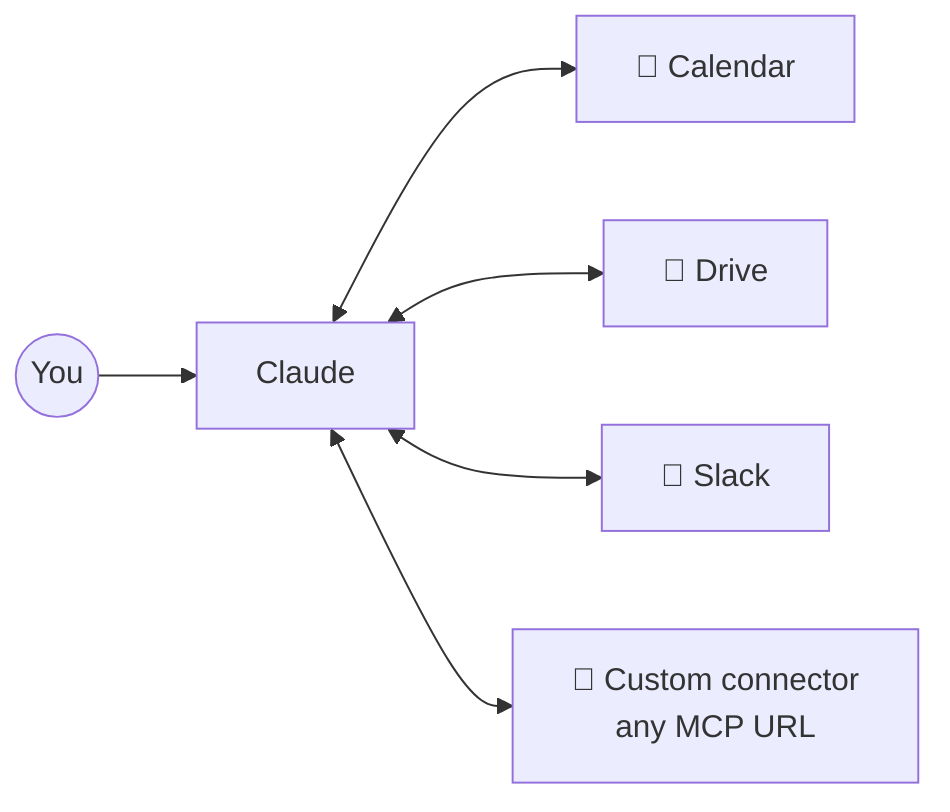
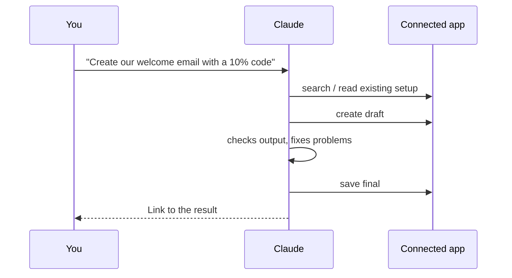

# 2. Connectors

Connectors are the chat app's front-end for MCP servers ([MCP lesson](../03-extending-claude/03-mcp.md)): they let Claude read from and act in the apps where your real work lives.

## Connecting
1. *Customize → Connectors → Browse* (or **Add custom connector** with a server URL).
2. Authenticate and review the requested permissions carefully.
3. If a connector shows "needs connection" in a chat, click **Connect** from the chat's **+** menu.

## Read *and* write
Connectors aren't just for lookups. In the beginner video, a marketing-platform connector let Claude draft and create a complete email campaign inside that platform — the user never opened its editor.

## Permissions
Claude asks before each action. Use **Always allow** only for actions you're comfortable with, especially for writes and deletes.

➡️ Next: [File automation & scheduled tasks](03-cowork.md)
