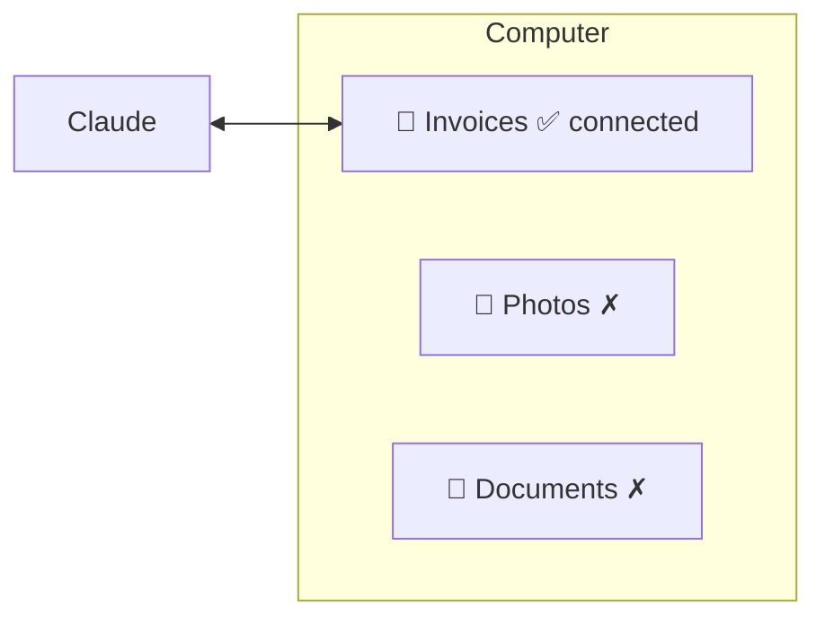

# 3. File Automation & Scheduled Tasks

> In the videos this appears as "Cowork". Its capabilities are now part of Claude itself — the ideas below apply regardless of the name.

Claude can work on **folders you explicitly connect** — nothing else on your computer is visible.



## Example: the boring hour

```text
Go through every PDF in this folder. Extract date, supplier and total
into a spreadsheet. Then rename each file to YYYY-MM-DD_supplier.pdf.
```


## Approval levels

| Level | Use when |
|---|---|
| Manual approval | First runs — see exactly what Claude does |
| Automatic approval | Trusted, repeated jobs (it still pauses for risky steps) |

## Scheduled tasks
Same idea as [Routines](../04-daily-workflow/05-routines.md): describe the job, the time, and the level of detail.

```text
Every Monday at 06:30, research the latest news on <topic>
and write a detailed report.
```

After the first run, set future runs to automatic approval so they don't stall waiting for you.

**Challenge:** pick one folder with one boring job in it, connect only that folder, and hand the job over.

➡️ Next: [Claude Design → Claude Code](04-design-to-code.md)
