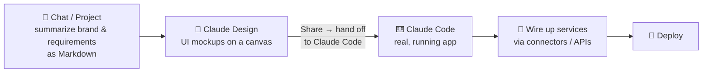
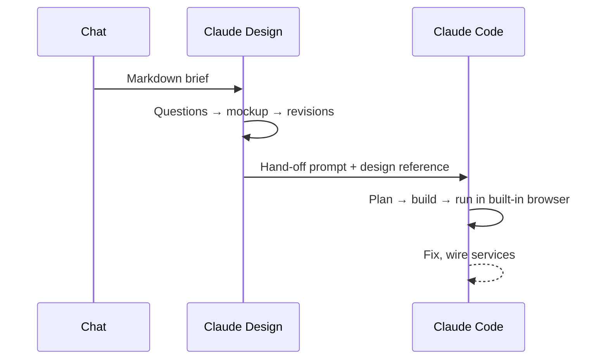

# 4. Claude Design → Claude Code

A full pipeline from idea to working app, using the strengths of each tool.

## Step by step

| Step | Tool | What you do |
|---|---|---|
| 1. Brief | Chat (inside a project) | Ask Claude to summarize everything relevant (brand, audience, features) into one Markdown brief |
| 2. Design | Claude Design | Paste the brief; pick a UI-mockup project type; strongest model, high effort; answer its questions |
| 3. Iterate | Claude Design | Upload real images; tweak via chat or the adjustment panel |
| 4. Hand off | Claude Design → Share | Send to local Claude Code, copy the generated prompt |
| 5. Build | Claude Code | Open a new folder, paste the prompt, Auto mode, Opus + high effort |
| 6. Polish | Claude Code | Add assets, wire integrations (API keys go in `.env`, never in code) |

## Why split it?
- **Design** is purpose-built for visual iteration: canvas, adjustable parameters, image uploads.
- **Code** is built for files, dependencies, running and testing.
- A mockup looks interactive but has no backend — Claude Code makes it real.

➡️ Next: [Build tools, not answers](05-build-your-own-tools.md)
