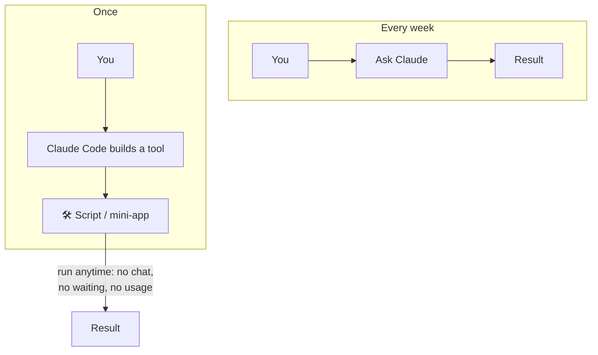
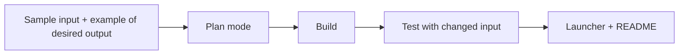

# 5. Build Tools, Not Answers

The top of the ladder: instead of asking Claude to *do* a job each time, ask it to **build a small program that does the job forever**.



## The video's example
A tool that reads a product spreadsheet and generates printable labels. When a product is added or renamed in the spreadsheet, you just run the tool again — Claude isn't involved anymore.

## Good candidates
| Repeated job | Tool to build |
|---|---|
| Labels / reports from a spreadsheet | Generator script with a desktop shortcut |
| Renaming & sorting files | Folder-watcher script |
| Nightly photo / project backup | Scheduled backup script |
| Log → summary | CLI that parses logs into a table/Markdown |
| Test results → dashboard | Static HTML report generator |

## Prompt template

```text
Build me a small tool that <does X> from <input file/folder>.
Output: <format & location>.
It must keep working when I <add/change input>.
Give me a double-clickable launcher on the desktop.
Use <language>; no external services. Include a README.
```



## Even further
Claude Code can run **several agents in parallel** on different parts of a bigger build ([parallel sessions](../04-daily-workflow/03-parallel-sessions-worktrees.md), [subagents](../03-extending-claude/02-subagents.md)).

✅ **Module complete.** Continue with [06 Learning with AI](../06-learning-with-ai/README.md).
