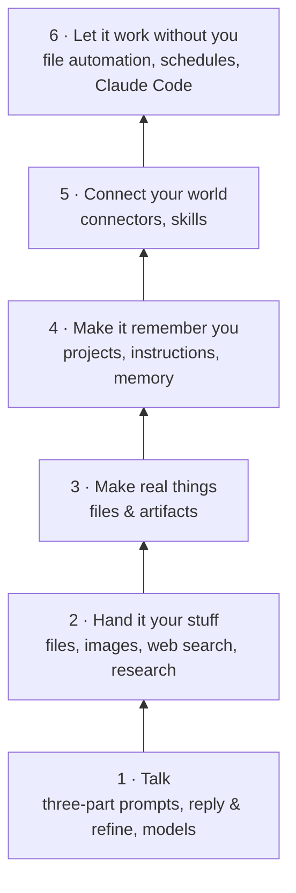

# Module 05 — Beyond Code

**Goal:** see how Claude Code fits into the wider Claude ecosystem — knowledge projects, connected apps, file automation, design-to-code, and building your own tools.

| # | Lesson | Time |
|---|---|---|
| 1 | [Projects & memory in the Claude app](01-projects-and-memory.md) | 10 min |
| 2 | [Connectors](02-connectors.md) | 10 min |
| 3 | [Cowork-style file automation & scheduled tasks](03-cowork.md) | 10 min |
| 4 | [Claude Design → Claude Code](04-design-to-code.md) | 15 min |
| 5 | [Build tools, not answers](05-build-your-own-tools.md) | 15 min |
| 6 | [Building with the Claude API & RAG](06-building-with-claude-api-and-rag.md) | Deep Dive |

## The six-level ladder (from the beginner video)

The same skill runs through every level: **give context, give a task, refine the result.**
