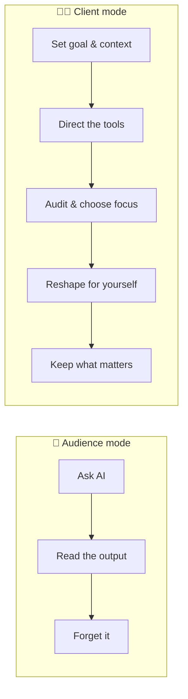
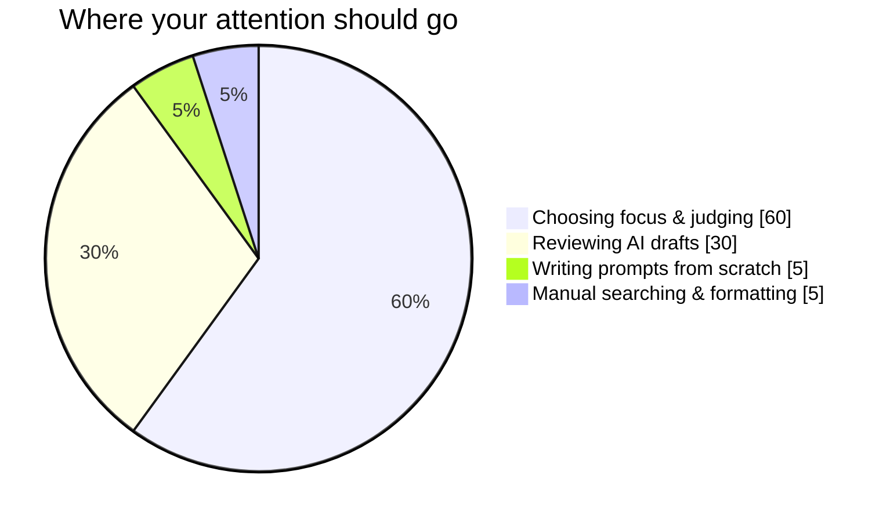

# 1. Be the Client, Not the Audience

AI can now run almost the entire learning process itself: it finds sources, summarizes them, explains them and builds slides. The trap is that **you end up watching AI learn for you**. That gets you answers faster, but you haven't learned anything faster.

## The client's responsibilities

| You decide… | Why it matters |
|---|---|
| **The goal and context** | Shapes every prompt in the workflow |
| **Which sources to trust** | AI-gathered sources often contain SEO marketing, duplicates or fabricated entries |
| **Which questions deserve attention** | Prevents a generic, scattered summary |
| **What form helps *you* understand** | A table, a deck, an interactive map, whatever works for how you read |
| **What to keep** | Your archive is an index of *your* thinking, not of everything AI produced |

## Save mental energy for the parts that matter

Let AI do the work your brain doesn't need to do, such as drafting prompts, collecting sources and reformatting. Then spend your attention on judgment.

➡️ Next: [Stage 1 — Collect](02-collect.md)
