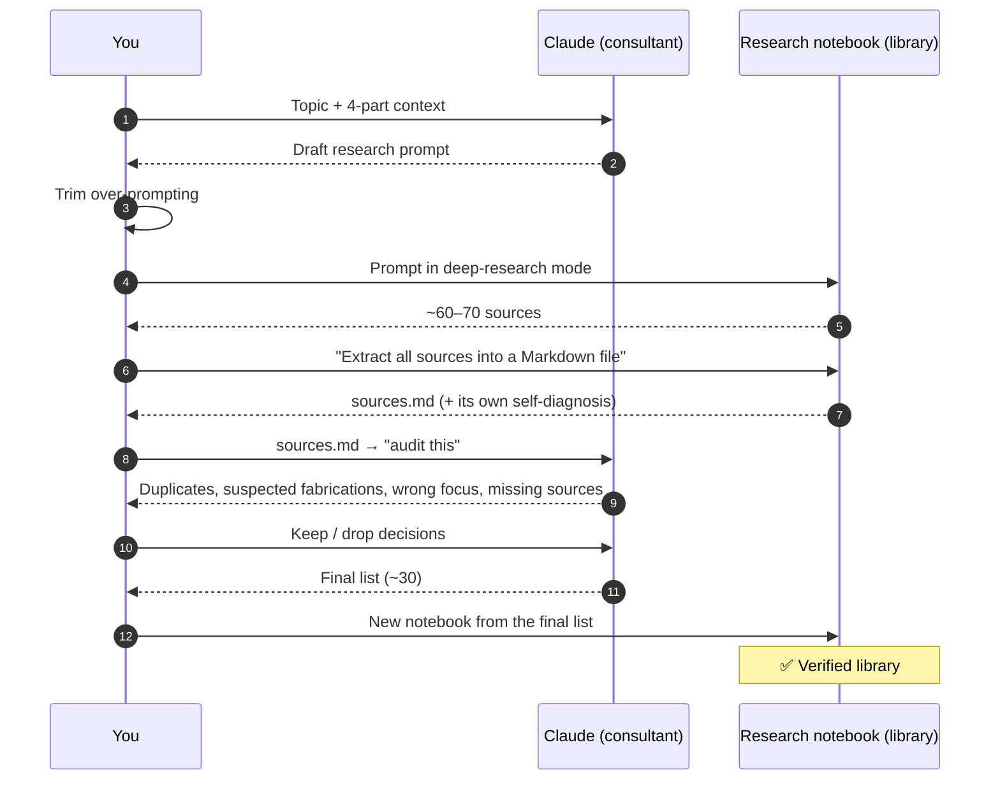
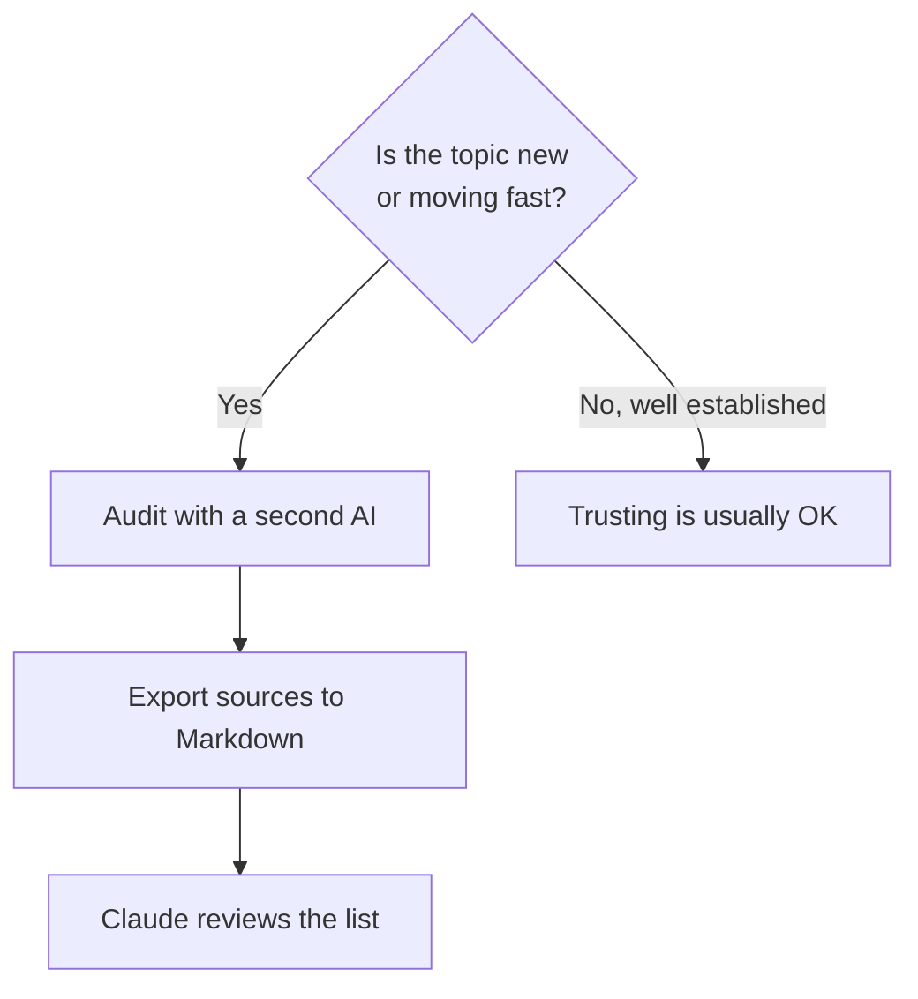

# 2. Stage 1 — Collect: Build a Library You Can Trust

**Goal:** a curated set of sources that you've checked, collected without exhausting yourself before the real learning starts.



## Step 1 — Write the brief with Claude

Don't write the research prompt from zero. Give Claude the **four things every research brief needs** and ask it to draft the prompt:

| Context item | Example |
|---|---|
| 🎯 **Goal** | "Compare prompt, context, harness and loop engineering to decide how to design my test agent" |
| 📏 **Depth** | "Practitioner-level, not academic; enough to make design decisions" |
| 🧑 **Background** | "Automotive test engineer, strong Python, built RAG systems, new to agent harnesses" |
| ✅ **Good sources** | "Official docs, engineering blogs from labs, papers, talks by practitioners. No listicles, no vendor comparisons" |

Template: [`examples/learning-archive/templates/research-brief.md`](https://github.com/CagriCatik/claude-ollama-coder/tree/main/examples/learning-archive/templates/research-brief.md)

> ⚠️ **AI tends to over-prompt.** Read the draft and cut anything that doesn't serve your goal.

## Step 2 — Deep research in the notebook
Paste the prompt into the research notebook, run its **deep research** mode, and remove sources that failed to load.

## Step 3 — Audit (especially for fast-moving topics)

Nobody reads 60+ sources. You either **trust** the list or **audit** it.



Ask Claude to look for problems like these:

| Problem | Example from the video |
|---|---|
| Duplicates | Same article from two URLs |
| Possibly fabricated sources | Titles or authors that don't seem to exist |
| **Wrong focus** | Many "10 best MCP gateways" articles, which are SEO marketing that would pull the whole synthesis toward vendor comparison |
| Gaps | Important primary sources that are missing, which Claude can suggest |

> The research notebook's own self-check flagged *different* problems than the second AI did. That's why a second opinion is worth having.

### Audit prompt
```text
Here is a source list for research on <topic>. My goal: <goal>.
Audit it: flag duplicates, possibly fabricated or unverifiable sources,
marketing/SEO content, and anything that would skew the focus away from
my goal. Suggest up to 5 missing high-quality sources.
Output a table: source | keep/drop | reason.
```

## Step 4 — Rebuild a clean notebook
Create a new notebook from only the kept sources. In the video this took under 5 minutes and went from 64 sources to about 30.

✅ **Outcome:** a verified library, and you still have the energy for Stage 2.

➡️ Next: [Stage 2 — Understand](03-understand.md)
