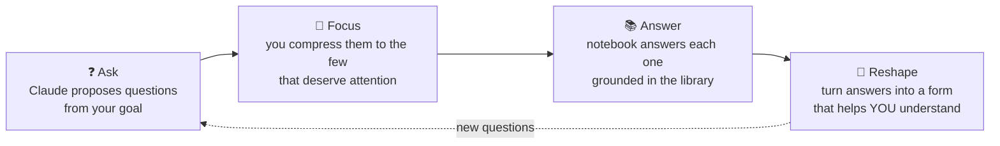
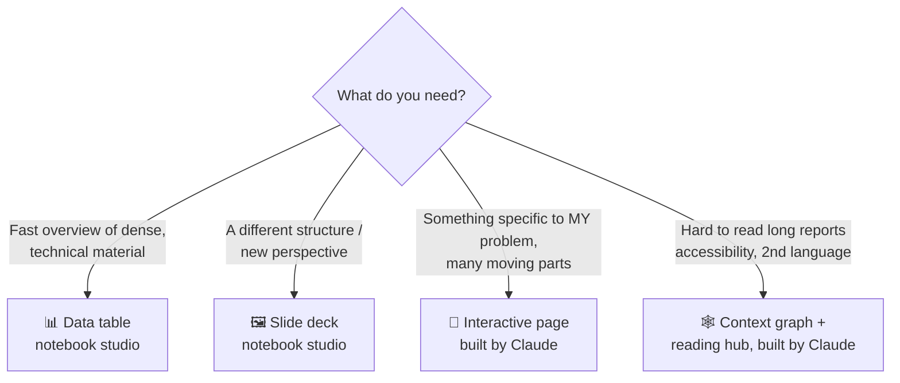
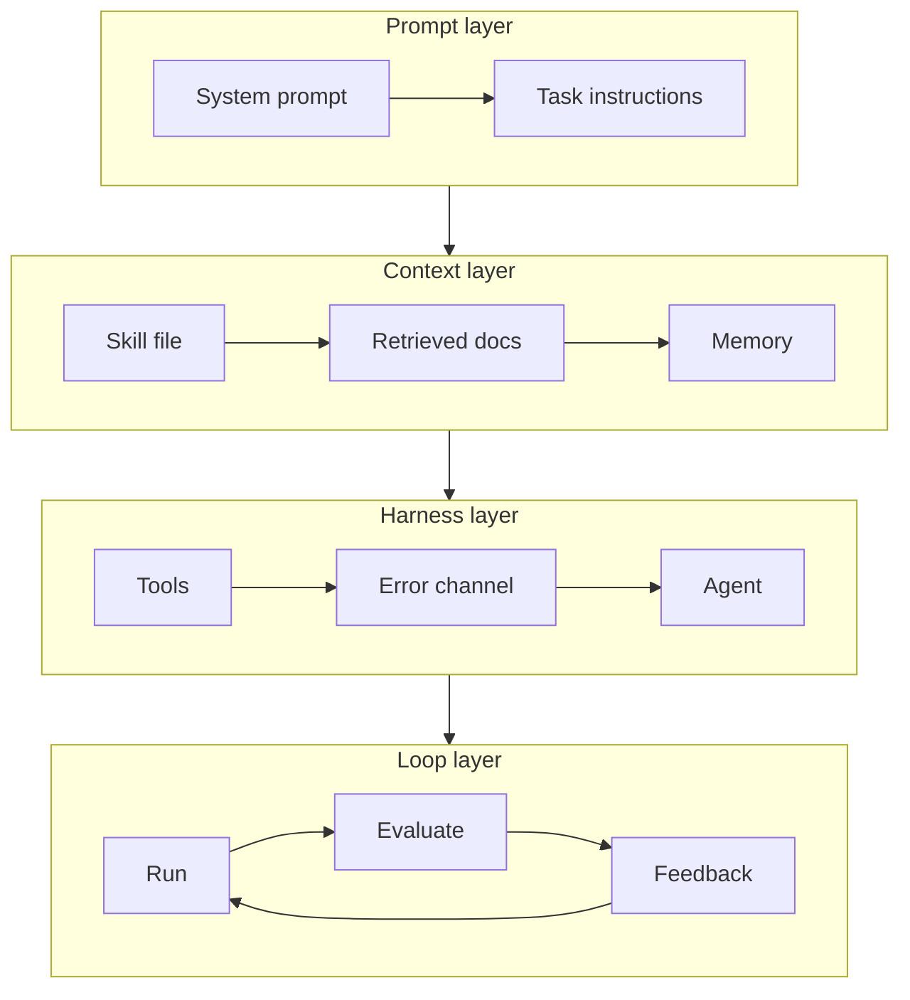

# 3. Stage 2 — Understand: Ask, Focus, Reshape

AI explains brilliantly. It can turn a pile of text into a summary, report or deck faster than you can absorb it. So the output itself matters less than **the choices you make around it**.

## The mini loop



### Ask → Focus
Tell Claude your purpose and goal and let it suggest questions. In the video Claude produced six blocks of questions. Don't copy them blindly. **Compress them into a small "attention zone"** of about five questions that you actually care about.

```text
My goal: <goal>. My background: <background>.
Suggest the questions I should answer to reach this goal, grouped by theme.
```

### Answer
Ask the notebook your questions **one at a time**, so each answer is grounded in your curated library.

## Reshape: pick the right format



| Format | Tool | Best for |
|---|---|---|
| **Data table** | Notebook studio output | Condensing dense technical material without getting overwhelmed |
| **Slide deck** | Notebook studio output | Seeing the same information in another structure |
| **Interactive page** | Claude | Applying concepts to *your* specific problem |
| **Context graph + reading hub** | Claude | Navigating a long report visually: the map shows structure, the hub gives detail |

> 💡 **Generate decks from your *answers*, not the whole library.** If you use the whole library, the notebook decides what matters and you get a generic summary. Your answers already reflect your focus.

## Example: when text answers stop working

Question: *"For one specific task, how does the setup change across prompt, context, harness and loop design?"*

The prompt and context layers are easy to follow in text. The harness and loop layers bring in tools, agents and feedback, and become hard to hold in your head. So ask Claude to reshape the answer into an interactive page:



On the page, every box can be clicked to reveal a concrete example: what the skill file contains, or what an error message looks like when it flows back to the agent. Each abstract concept is tied to something concrete.

```text
Here are my answers on <topic>. Reshape them into an interactive page
around MY task: <task>. Show each layer as a workflow; clicking a box
should reveal a concrete example (file contents, message format, etc.).
```

➡️ Next: [Stage 3 — Own](04-own.md)
