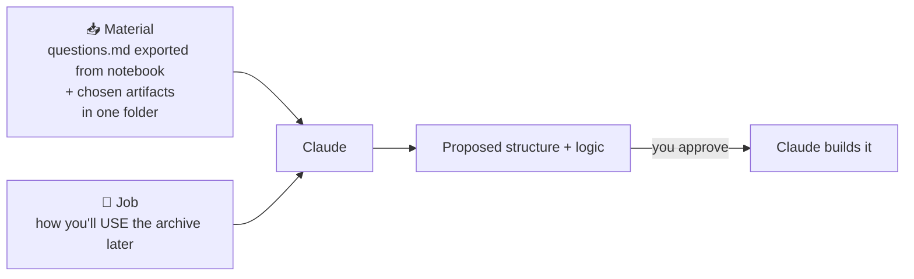
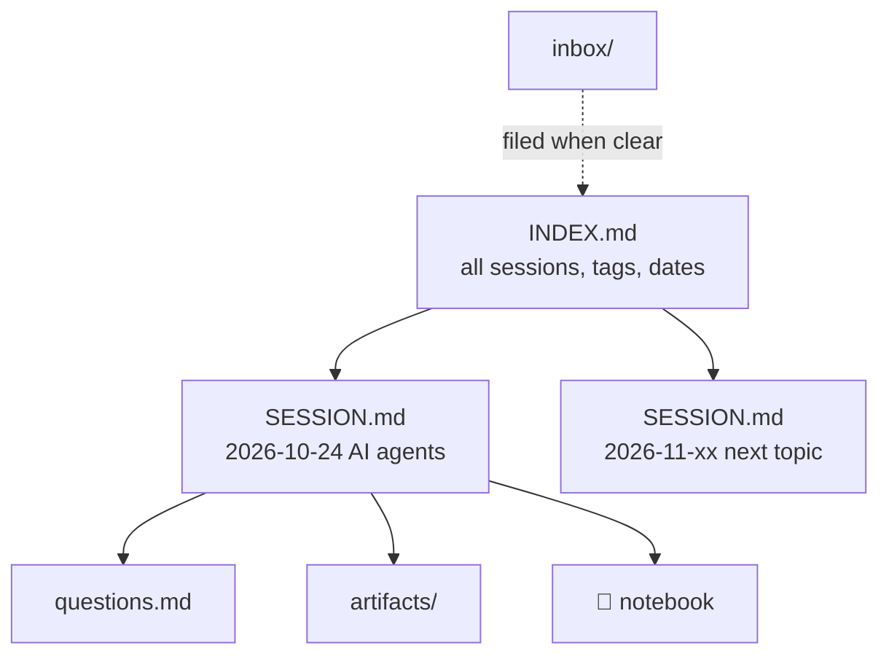

# 4. Stage 3 — Own: An Archive Your Future Self Can Use

Learning something is only the beginning. To **own** it, you need to capture, organize and retrieve it when you need it. Claude with folder access acts as your **librarian**: it designs and maintains a folder system on your computer.

## Decide what's worth keeping

The archive is **an index of your own thinking**, not a dump of everything AI produced.

| Keep | Why |
|---|---|
| ❓ **Your questions** | They show the path your thinking took |
| 🧩 **Artifacts** you chose to develop | They capture the parts you went deeper on |
| 🔗 **Notebook link** | Gets you back to the original sources |

**Success test:** *"If I come back to this topic in 3 weeks, can I see what I learned, how far I got, and get back to the sources?"*

## Give Claude the material and the job, not the structure



Describe **how you will use** the archive, not which folders to create. The structure follows from the use.

```text
This folder contains my learning material. I want an archive I can come
back to weeks later and ask things like "what did I learn about X?",
"what did I learn in June?", or "show all my questions about Y".
For each session I keep: my questions, the artifacts I chose, and a link
to the research notebook. Propose a structure and the logic behind it,
explain how it scales, and put anything you're unsure about in an inbox
instead of guessing. Don't build until I approve.
```

## The resulting structure (as in the video)

```text
learning-archive/
├── INDEX.md                         ← top-level index, written for AI to read
├── inbox/                           ← anything Claude wasn't sure how to file
└── sessions/
    └── 2026-10-24_ai-agent-engineering/
        ├── SESSION.md               ← notebook link, tags, file list, summary
        ├── questions.md             ← the questions, in the order asked
        └── artifacts/
            └── layer-explorer.html
```



- **One folder per learning session**, named `YYYY-MM-DD_topic`.
- **INDEX.md** and **SESSION.md** are written mainly *for AI*. They tell Claude where the notebook lives and which files belong to which session, so it can answer without opening every artifact.
- **Inbox, not guessing.** Uncertain items wait for you.

Template: [`examples/learning-archive/`](https://github.com/CagriCatik/claude-ollama-coder/tree/main/examples/learning-archive/)

## Retrieval

Open a chat with folder access to the archive and ask:

```text
What did I learn about AI agents?
```

Claude finds the session, reports its date and tags, shows the progression of your questions, links back to the notebook, and lists the artifacts without opening them.

Queries that become valuable once the archive grows:
- *"What did I learn in June?"*
- *"Pull out every question I've asked about harness engineering."*
- *"Which topics did I start but never go deep on?"*

## Make it a habit (optional, using Module 03)
- Put the filing rules in a **skill** (`/file-session`) so every new session is archived the same way.
- Add a `CLAUDE.md` to the archive with the conventions. The template includes one.
- A monthly **routine** can tidy the inbox and refresh `INDEX.md`.

✅ **Module complete.** Head to [Lab 09](../labs/lab-09-learning-workflow.md) or continue with [07 Running with Ollama](../07-running-with-ollama/README.md).
