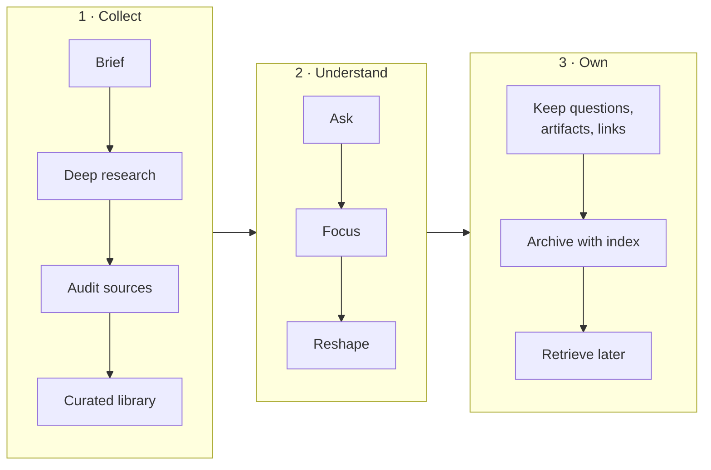

# Module 06 — Learning Anything with AI

**Goal:** use Claude (plus a source-grounded research notebook such as Gemini NotebookLM) to learn a new topic fast **without letting AI do the learning for you**.

| # | Lesson | Time |
|---|---|---|
| 1 | [Be the client, not the audience](01-client-mindset.md) | 5 min |
| 2 | [Stage 1 — Collect: build a library you can trust](02-collect.md) | 15 min |
| 3 | [Stage 2 — Understand: ask, focus, reshape](03-understand.md) | 15 min |
| 4 | [Stage 3 — Own: an archive your future self can use](04-own.md) | 15 min |

## The workflow

## Who does what

| Role | Tool | Job |
|---|---|---|
| 🧑‍💼 **You — the client** | — | Set direction, decide what deserves attention, make the final judgment |
| 🧠 **Consultant** | Claude (or any chatbot you prefer) | Plan, write prompts, audit sources, reshape answers, design the archive |
| 📚 **Librarian / library** | Research notebook (e.g. Gemini NotebookLM) | Gather sources, hold the library, answer *grounded in it* |
| 🗂️ **Archivist** | Claude with folder access (desktop app / Claude Code) | Build and maintain the folder archive |

> **Speed comes from the tools. Quality comes from you:** how you direct them, the context you give, and what you choose to keep.

## How this connects to the rest of the course
- **Collect** uses [three-part prompting](../01-core-concepts/01-prompting.md) and [plan-mode-style questioning](../01-core-concepts/05-plan-mode-workflow.md).
- **Understand** uses Claude to build interactive pages, which are the same kind of artifacts covered in [Module 05](../05-beyond-code/README.md).
- **Own** uses folder access, [CLAUDE.md](../02-project-context/01-claude-md.md)-style index files, and optionally a [skill](../03-extending-claude/01-skills.md) to file new sessions.

➡️ Practice: [Lab 09 — Learning workflow](../labs/lab-09-learning-workflow.md) · Template: [`examples/learning-archive/`](https://github.com/CagriCatik/claude-ollama-coder/tree/main/examples/learning-archive/)
