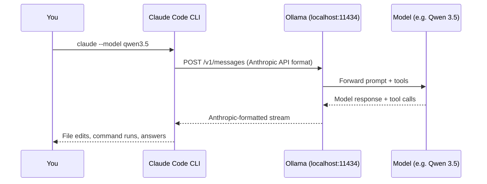

# 1. Quickstart & Setup

Ollama bridges Claude Code to open-source models using its Anthropic-compatible API. You can launch Claude Code with a single Ollama command or configure your terminal environment manually.



---

## Method 1: The One-Liner (`ollama launch`)

If you have Ollama installed, the fastest way to start is the `ollama launch` command:

```bash
ollama --version    # verify installation (e.g. 0.40+)
ollama list         # inspect currently downloaded models
ollama launch claude
```

What this command does automatically:
1. Verifies or downloads Claude Code.
2. Prompts you to pick a compatible local or cloud model (e.g. Qwen 2.5 Coder, Gemma, GLM).
3. Automatically sets the necessary API endpoints and auth tokens.
4. Spawns Claude Code directly in your current directory.

### Switching Models with `--config`

If you have multiple models installed or want to switch your active model without manually setting environment variables:

```bash
ollama launch claude --config
```

This opens an interactive menu allowing you to choose between your installed local models and cloud providers before launching.

To reset any saved integration profiles back to factory defaults:
```bash
ollama launch claude --restore
```

### Workspace Safety Check
On your first launch in any folder, Claude Code will ask:
> *Quick safety check: is the current project created or one trusted like you own the code or well-known open source project?*

Select **Yes** for your own projects to enable read, edit, and tool permissions.

### Automated Setup Script (`setup-ollama.sh`)

This tutorial includes an automated setup script in the repository root:

```bash
./setup-ollama.sh                  # Setup with default model (qwen2.5-coder:7b)
./setup-ollama.sh gpt-oss:20b-cloud # Setup with an existing or preferred model
./setup-ollama.sh --skip-pull      # Configure launcher without pulling new models
```

The script automatically verifies your environment, ensures the Ollama daemon is running on port 11434, tests inference, and generates a convenient `./launch-claude-ollama.sh` launcher.

---

## Method 2: Manual Environment Variable Setup

If you prefer using the standard `claude` CLI directly, install Claude Code and configure three environment variables.

### Step 1: Install Claude Code

**macOS / Linux:**
```bash
curl -fsSL https://claude.ai/install.sh | bash
```

**Windows (PowerShell):**
```powershell
irm https://claude.ai/install.ps1 | iex
```

### Step 2: Set Environment Variables

Configure your shell to route requests to Ollama instead of Anthropic's servers:

```bash
export ANTHROPIC_AUTH_TOKEN=ollama
export ANTHROPIC_API_KEY=""
export ANTHROPIC_BASE_URL=http://localhost:11434
```

> **Why empty `ANTHROPIC_API_KEY`?** Clearing this ensures Claude Code does not attempt to authenticate against Anthropic's cloud with a stale Anthropic key, while `ANTHROPIC_AUTH_TOKEN` satisfies the client requirement for a bearer token.

### Step 3: Run Claude Code with your model

Launch Claude Code and specify which model Ollama should serve:

```bash
claude --model qwen3.5
```

You can also pass the variables inline for a single session without altering your shell profile:

```bash
ANTHROPIC_AUTH_TOKEN=ollama \
ANTHROPIC_BASE_URL=http://localhost:11434 \
ANTHROPIC_API_KEY="" \
claude --model kimi-k2.7-code:cloud
```

---

## Verifying the Connection

Once inside Claude Code, run the status slash command:

```text
/status
```

Check the output for:
- **Model:** shows the model name you specified (e.g. `qwen3.5` or `kimi-k2.7-code:cloud`).
- **Base URL:** confirms `http://localhost:11434` is active.

```text
> /status
Model: qwen3.5
API Base URL: http://localhost:11434
Context Window: 65,536 tokens
```

---

## Common Gotchas

| Issue | Cause | Fix |
|---|---|---|
| **Connection refused** | Ollama daemon is not running | Run `ollama serve` or open the Ollama desktop app |
| **Requests going to Anthropic** | Claude settings file overrides shell variables | Check `~/.claude/settings.json` or `.claude/settings.json` for fixed `apiKey` or `baseUrl` properties |
| **Model not found error** | Model hasn't been pulled locally yet | Run `ollama pull <model-name>` first, or use `ollama launch claude` |

➡️ Next: [Selecting models & context](02-selecting-models-and-context.md)
