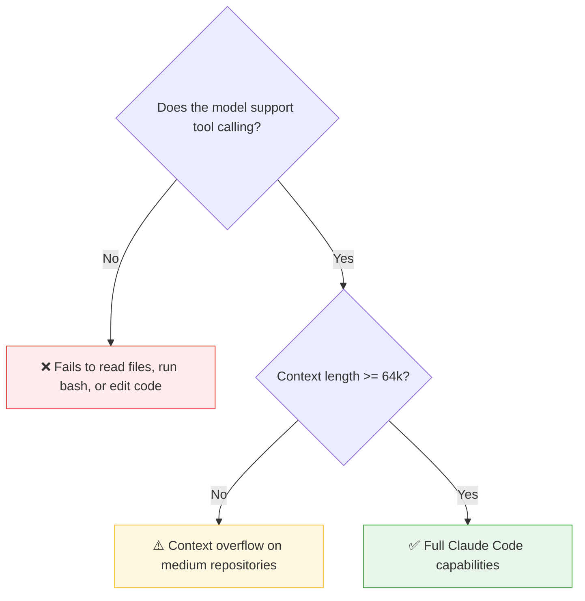
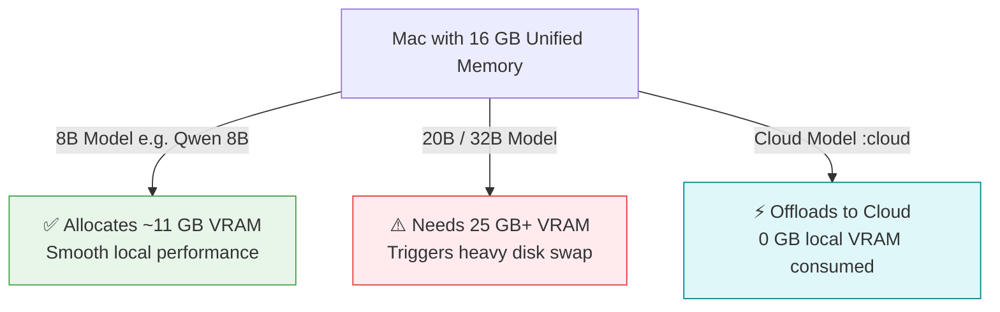

# 2. Selecting Models & Context

Unlike standard chat applications, Claude Code is an **agentic system**. It continuously executes tools (reading files, parsing directory trees, running bash commands, editing code chunks). Because of this, two factors determine success with Ollama: **tool-calling support** and **context length**.

---

## 1. Tool-Calling Support is Mandatory

Not every model supports tool calling. If a model cannot reliably generate structured tool calls, Claude Code will fail to inspect files or execute commands.



### Recommended Models

| Model | Type | Best for | Strengths |
|---|---|---|---|
| **Qwen 2.5 Coder / 3.5** (7B–32B) | Local | Local developer workstations | Top-tier code edits, robust tool calling, fast |
| **Llama 3.1 / 3.3** (70B) | Local / Cloud | High-complexity reasoning | Broad general knowledge, strong system adherence |
| **Kimi k2.7-code** | Cloud | Large multi-file refactors | Long context handling, strong tool calling |
| **Gemma 4** | Cloud | Lightweight tasks & scripts | Fast inference, cost-effective |
| **GLM-5.3-flash** | Cloud | Fast interactive development | Quick response times, solid tool calling |

Browse available models:
- **Local tool models:** [ollama.com/search?c=tools](https://ollama.com/search?c=tools)
- **Cloud models:** [ollama.com/search?c=cloud](https://ollama.com/search?c=cloud)

---

## 2. The 64k+ Context Requirement

Claude Code sends substantial prompt overhead with every request:
- System prompt and CLI behavior rules.
- Tool schemas (read, edit, bash, subagent, grep, glob).
- Project instructions from `CLAUDE.md`.
- Project memory and active directory files.

> [!NOTE]
> Default Ollama models often instantiate with a 2,048 or 4,096 token context window. In Claude Code, this fills up on the very first prompt. **Always set a context window of 65,536 (64k) or higher.**

### Configuring Context Length in Ollama

You can create a custom `Modelfile` with the context size configured:

```dockerfile
# Modelfile
FROM qwen2.5-coder:14b

# Set 64k context window
PARAMETER num_ctx 65536
```

Then build and launch your customized model:

```bash
ollama create qwen-coder-64k -f Modelfile
claude --model qwen-coder-64k
```

Alternatively, when using cloud models, Ollama manages the expanded context window automatically.

---

## 3. Supported Features & Nuances

| Feature | Local Ollama | Ollama Cloud | Notes |
|---|---|---|---|
| **File edits** | ✅ | ✅ | Models must accurately produce diffs or replacements |
| **Bash execution** | ✅ | ✅ | Standard permission prompts apply |
| **Subagents** | ✅ | ✅ | Launches subagent workers with independent context |
| **Thinking** | ✅ | ✅ | Supported on thinking-compatible models (e.g. DeepSeek-R1) |
| **Vision** | ✅ | ✅ | Works with multimodal models (e.g. Llama 3.2 Vision) |
| **Hosted WebSearch** | ⚠️ | ✅ | Ollama Cloud supports native web search; local requires Ollama web search API |

---

## Hardware Sizing Guide (Mac & PC)

Running coding models with 64k+ context requires understanding your hardware's VRAM limits:



| Machine / VRAM | Recommended Local Model | Notes |
|---|---|---|
| **16 GB Mac (M1/M2/M3/M4)** | **Qwen 2.5 Coder 8B** or **Gemma 9B** | Uses ~11 GB VRAM; leaves ~5 GB for macOS and your IDE. Perfect local sweet spot. |
| **24 GB – 36 GB Mac / PC** | **Qwen 2.5 Coder 14B** | Higher reasoning accuracy, handles multi-file edits with ease. |
| **48 GB – 64 GB Mac** | **Qwen 32B** or **GPT-OSS 20B** | Near-frontier local coding accuracy with full 64k+ context. |
| **128 GB+ / Dual GPU** | **Llama 3.3 70B** | Enterprise-grade local offline development. |

### The Cloud Model Alternative: Free Quotas Without Local VRAM

If your local Mac has 16 GB or less and you hit accuracy limits with 8B models:
- Choose cloud-hosted open models (`ollama launch claude --model glm-4.7:cloud` or `kimi-k2.7-code:cloud`).
- **Token Quota:** Cloud tiers often include generous allowances (e.g. GLM Cloud provides ~250,000 input tokens per hour free). Since a full Claude Code conversation context is 200,000 tokens, this covers roughly one entire deep coding session every hour completely free.

➡️ Next: [Headless automation & `/loop`](03-headless-and-automation.md)
