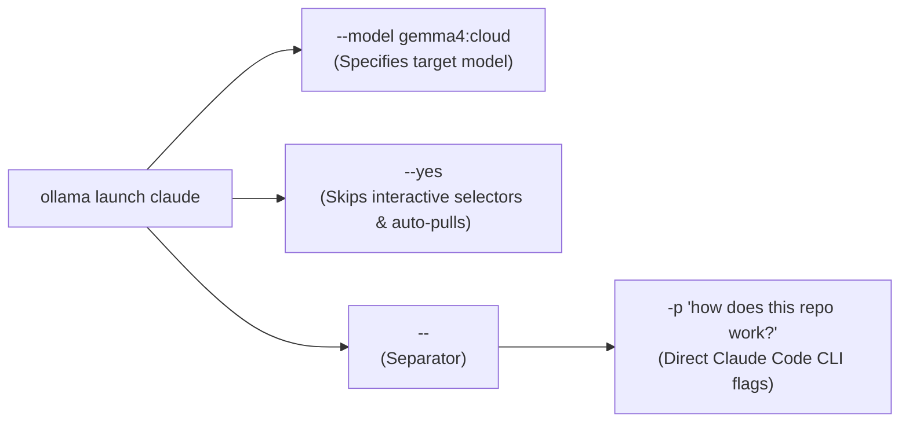
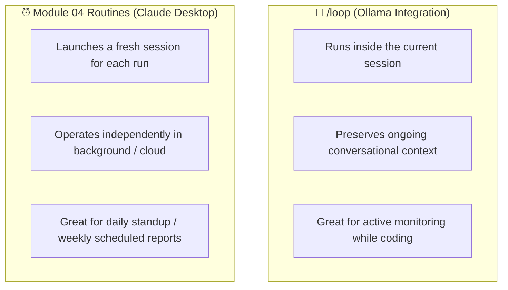

# 3. Headless Automation & Scheduled Loops

Ollama adds two powerful capabilities for automated and recurring development workflows: non-interactive execution (`--yes`) and scheduled in-session prompts (`/loop`).

---

## 1. Running Headless (CI/CD & Scripts)

When running Claude Code in Docker containers, shell scripts, or CI pipelines, you cannot have interactive terminal prompts asking to select models or confirm model downloads.

Use the `--yes` flag with `ollama launch`:

```bash
ollama launch claude --model gemma4:cloud --yes -- -p "how does this repository work?"
```



### How `--yes` Works

1. **Requires `--model`:** You must explicitly declare the model.
2. **Auto-pulls missing models:** If the local or cloud model is not yet cached, Ollama pulls it automatically without interactive confirmation.
3. **Passes arguments after `--` directly to Claude Code:** Flags like `-p` (execute one prompt and exit), `--dangerously-skip-permissions` (for sandboxed CI), or `--output-format` are forwarded to the Claude engine.

### Example: Automated PR Review in a GitHub Action

```yaml
# .github/workflows/ai-review.yml
name: Local AI Code Review
on: [pull_request]

jobs:
  review:
    runs-on: self-hosted
    steps:
      - uses: actions/checkout@v4
      - name: Run automated review with Ollama
        run: |
          ollama launch claude --model qwen2.5-coder:14b --yes -- \
            -p "Review git diff origin/main...HEAD against conventions in CLAUDE.md. List potential bugs."
```

---

## 2. Scheduled In-Session Tasks with `/loop`

Inside a Claude Code session backed by Ollama, you can run prompts or slash commands automatically at recurring intervals using `/loop`:

```text
/loop <interval> <prompt or /command>
```

Supported intervals include minutes (`m`) and hours (`h`).

### Examples

**Triage PRs every 30 minutes:**
```text
/loop 30m Check my open PRs and summarize their status
```

**Monitor GitHub issues every 15 minutes:**
```text
/loop 15m Check for new GitHub issues, verify reproduction steps, and triage by priority
```

**Keep up with industry updates every hour:**
```text
/loop 1h Research the latest AI news and summarize key developments
```

### `/loop` vs. Module 04 Routines



---

## 3. Autonomous Permission Management

When running unattended loops or headless scripts, prompts requesting bash or file edit approval would stall execution.

You have two choices:

1. **Granular Rules in `settings.json` (Recommended):**
   Explicitly pre-approve safe commands in `.claude/settings.json`:
   ```json
   {
     "permissions": {
       "allow": [
         "Bash(git status)",
         "Bash(git diff *)",
         "Bash(pytest *)",
         "Edit(reports/**)"
       ]
     }
   }
   ```
2. **Bypass Permissions in Sandboxes:**
   In disposable containers or isolated virtual machines only:
   ```bash
   ollama launch claude --model gemma4:cloud --yes -- --dangerously-skip-permissions -p "Run test suite and fix failing tests"
   ```

➡️ Next: [Cloud models & channels](04-cloud-and-channels.md)
