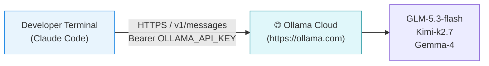
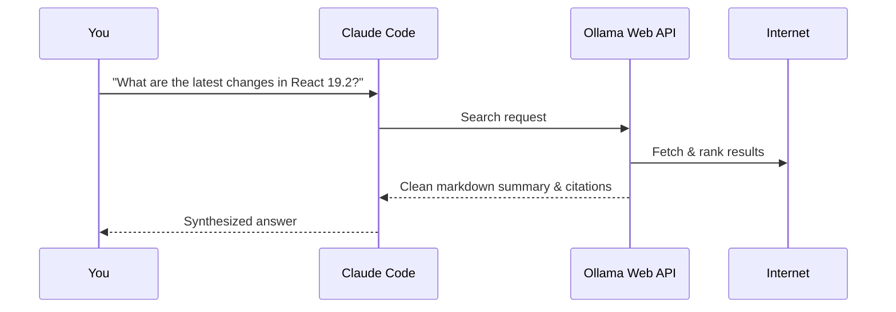
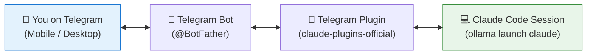

# 4. Cloud Models & Channels

You do not need a beefy GPU or even a local Ollama daemon to use Ollama with Claude Code. You can connect directly to Ollama Cloud for serverless inference, leverage web search, or control your Claude Code session over Telegram.

---

## 1. Connecting Directly to Ollama Cloud

With an Ollama API key, you can run Claude Code against high-performance cloud-hosted open models (like `glm-5.3-flash` or `kimi-k2.7-code:cloud`) without installing the Ollama daemon locally.



### Setup

1. Obtain an API key from your [Ollama account](https://ollama.com).
2. Export your key and point Claude Code's base URL to `https://ollama.com`:

```bash
export OLLAMA_API_KEY="your-api-key-here"

ANTHROPIC_BASE_URL=https://ollama.com \
ANTHROPIC_AUTH_TOKEN="$OLLAMA_API_KEY" \
ANTHROPIC_API_KEY="" \
claude --model glm-5.3-flash
```

> **Authentication note:** `ANTHROPIC_AUTH_TOKEN` carries the bearer token header. Always ensure `ANTHROPIC_API_KEY=""` so the client does not try to authenticate against Anthropic's endpoints.

Check the live connection inside Claude Code:
```text
/status
```

---

## 2. Web Search & Web Fetch

When paired with Ollama, Claude Code can access Ollama's web search API to retrieve live information and documentation.



This lets local models query current documentation without hallucinating obsolete package APIs.

---

## 3. Remote Control via Telegram Bot

You can connect a Telegram bot to your Claude Code session, allowing you to ask questions, review code, or trigger tasks from your phone while away from your desk.



### Setting Up the Telegram Channel

1. **Create a bot:** Open Telegram, message [@BotFather](https://t.me/BotFather), and create a new bot to receive your bot token.
2. **Install the plugin:** Add the official Telegram plugin from the Anthropic plugin repository:
   ```text
   /plugins install telegram@claude-plugins-official
   ```
3. **Launch with the Telegram channel flag:**
   ```bash
   ollama launch claude -- --channels plugin:telegram@claude-plugins-official
   ```

### Handling Permissions for Remote Bots

When chatting with Claude Code over Telegram, interactive confirmation prompts in your terminal can block the bot.
- In normal development: define explicit pre-approved patterns in `.claude/settings.json` (e.g. allowing read/test commands).
- In an isolated environment (e.g. dedicated VM or container): pass `--dangerously-skip-permissions` to let the bot operate autonomously.

---

## Summary: When to Use Ollama with Claude Code

| Scenario | Recommendation |
|---|---|
| **Proprietary code with strict zero-cloud policies** | Local Ollama + Qwen 2.5 Coder 32B or Llama 3.3 |
| **Offline work (airplanes, train travel, remote areas)** | Local Ollama + 14B or 32B model with 64k context |
| **Saving Anthropic subscription plan usage** | Ollama Cloud or local models for routine tasks |
| **Remote task orchestration from mobile** | `ollama launch claude` + Telegram channel plugin |
| **Unattended batch scripts / CI pipeline** | `ollama launch claude --yes -- -p "..."` |

➡️ Next: [Local model tactics & Storybook](05-local-model-tactics-and-storybook.md)
