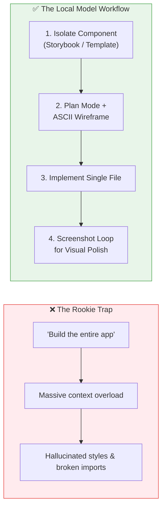

# 5. Local Model Tactics: Component Isolation, Wireframes & Screenshot Loops

Open-source 8B–14B models running on a Mac cannot match Claude 3.5 Sonnet or Opus in raw multi-file architectural reasoning. If you prompt an 8B model with *"Build the entire full-stack app"*, it gets overwhelmed by context, mixes up dependencies, and produces subtle UI bugs (like putting button text into a logo).

To get professional, production-grade output from local models, you must adapt your workflow to their strengths.



---

## 1. The Storybook Strategy: One Component at a Time

Instead of throwing an entire project directory into the prompt, break your user interface into **standalone, atomic components** using tools like [Storybook](https://storybook.js.org) or dedicated template files.

```bash
# Start Storybook for isolated component development
npm run storybook
```

**Why this transforms local model performance:**
- **Zero context bloat:** The model only reads the single component file and its CSS/tailwind definition.
- **Immediate testability:** You can see email templates, dialogs, buttons, and tables rendered in isolation.
- **Lower parameter demand:** A 7B or 8B model (like Qwen 2.5 Coder 8B) performs near frontier-level when constrained to a single 150-line file.

---

## 2. Plan Mode + Terminal ASCII Wireframes

Before letting a local model write code, use **Plan Mode** combined with a request for a terminal ASCII wireframe:

```text
/frontend-design
```

> **Prompt Pattern:**
> *"Based on the current email verification template, I want you to redesign the email to have a cleaner, more minimalistic look. Before you generate any code, switch to Plan Mode and create a terminal ASCII wireframe to show me the layout and visual hierarchy. Thanks."*

### Why the ASCII Wireframe Matters
Local models often make positioning errors on the first pass (e.g. putting verification actions in the header). An ASCII preview lets you catch structural misunderstandings in seconds before code is touched:

```text
+------------------------------------------+
|                 [LOGO]                   |
|                                          |
|            Verify Your Email             |
|                                          |
|   One tap to activate your account.      |
|   This link expires in 24 hours.         |
|                                          |
|           [ VERIFY NOW ]                 |
|                                          |
|   Need help? Contact support@acme.com    |
+------------------------------------------+
```

If the wireframe looks wrong, refine the prompt *in the plan* before approving file edits.

---

## 3. The Visual Screenshot Refinement Loop

Local models are significantly better at **iterative corrections** than zero-shot perfection. Use Claude Code's image support to create a tight visual feedback loop:

```mermaid
sequenceDiagram
    participant You
    participant Browser as Browser (Storybook)
    participant CC as Claude Code (Local / Cloud)

    You->>Browser: Inspect rendered component
    You->>CC: Paste screenshot + exact delta:
    Note over You,CC: "Icon is shifted left; center it.<br/>Revert background color to gray."
    CC->>CC: Inspect visual screenshot diff
    CC->>Browser: Update CSS / HTML
    Browser-->>You: Verified pixel-perfect fix
```

### Prompt Example with Image:
1. Take a screenshot of the rendered component.
2. In Claude Code, drag the screenshot into the prompt (or reference the image path):
   ```text
   Based on this screenshot of the rendered email:
   1. The email icon is shifted to the left — center it above the title.
   2. Revert the background color to gray (#f5f5f5) to match our brand card.
   ```

---

## 4. When to Escalate to Cloud Models

When a task exceeds an 8B local model's capability (such as intricate CSS grid alignments or multi-component state management), use `ollama launch claude --config` to escalate to a high-capacity cloud model:

| Task Type | Recommended Tier | Model | Cost |
|---|---|---|---|
| **Atomic component styling** | Local 8B | Qwen 2.5 Coder 8B / Gemma 9B | 100% Free, Offline |
| **Bug fixing in single function** | Local 8B | Qwen 2.5 Coder 8B | 100% Free, Offline |
| **Complex responsive layout** | Ollama Cloud | GLM 4.7 Cloud / Kimi k2.7 | Free Tier (~250k tok/hr) |
| **Full application architecture** | Anthropic Cloud | Claude 3.7 Sonnet / Opus | Pro / Max Plan |

---

## Key Takeaway

You don't need an expensive subscription for every coding task. By adopting **Component Isolation (Storybook)**, **Terminal Wireframe previews**, and **Screenshot feedback loops**, local 8B models on a 16 GB Mac deliver outstanding results for everyday development.

➡️ Next: [CLI tools & Python SDK](06-cli-tools-and-python-sdk.md)
