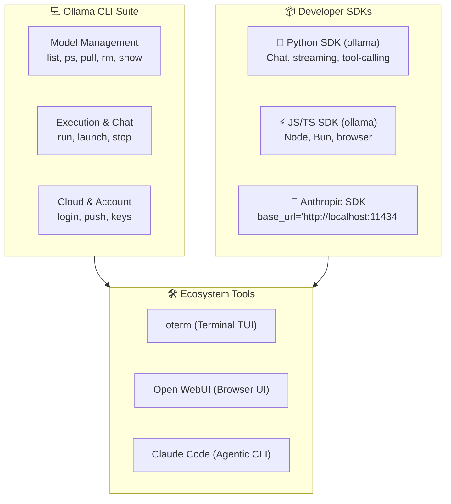

# 6. Ollama CLI Reference & Developer Ecosystem

A complete reference guide to Ollama's CLI commands, daemon configuration, official SDKs, and developer ecosystem tools.



---

## 1. Complete Ollama CLI Command Reference

### Model Management

| Command | Description | Example |
|---|---|---|
| `ollama list` | List all local and cloud models available on this machine | `ollama list` |
| `ollama ps` | Show models currently loaded into memory/VRAM | `ollama ps` |
| `ollama pull <model>` | Download or update a model from the registry | `ollama pull qwen2.5-coder:7b` |
| `ollama rm <model>` | Remove a model to free local disk space | `ollama rm deepseek-r1:1.5b` |
| `ollama cp <src> <dest>` | Duplicate or alias an existing model | `ollama cp qwen2.5-coder:7b my-coder` |
| `ollama create <name> -f <file>` | Create a customized model from a `Modelfile` | `ollama create coder-64k -f Modelfile` |

### Agent Launching (`ollama launch`)

Ollama can automatically configure and launch supported coding agents:

```bash
ollama launch claude                     # Interactive launch with model picker
ollama launch claude --config            # Configure/switch default model without launching
ollama launch claude --restore           # Reset integration back to default profile
ollama launch claude --model <model>     # Launch directly with target model
ollama launch claude --yes -- -p "..."   # Non-interactive headless prompt (CI/CD)
```

Other supported integrations: `chatgpt`, `openclaw`, `opencode`, `hermes`, `cline`, `vscode`.

### Direct Interactive Terminal Chat (`ollama run`)

To talk directly to a model without agentic coding features:

```bash
ollama run gpt-oss:20b-cloud
```

**In-Session Shortcut Commands:**
- `/?` or `/? shortcuts`: Show in-session help.
- `/bye` or `Ctrl + D`: Exit the session.
- `"""`: Begin multi-line input (type `"""` again on a new line to send).
- `/set verbose`: Print token generation speed (tokens/second) and evaluation time.
- `/show info`: Display active model architecture and context length.

### Model Inspection (`ollama show`)

Inspect the internal prompt templates and parameters:

```bash
ollama show gpt-oss:20b-cloud                 # Full model card and license
ollama show gpt-oss:20b-cloud --modelfile     # View exact Modelfile definition
ollama show gpt-oss:20b-cloud --parameters    # View num_ctx, temperature, stop tokens
ollama show gpt-oss:20b-cloud --system        # View baked-in system prompt
```

---

## 2. Server Daemon Configuration & Environment Variables

The Ollama daemon can be customized using environment variables. On macOS, set these with `launchctl setenv` or run manually before `ollama serve`:

| Variable | Default | Purpose |
|---|---|---|
| `OLLAMA_HOST` | `127.0.0.1:11434` | Bind address. Set to `0.0.0.0:11434` for LAN access. |
| `OLLAMA_ORIGINS` | — | Allowed CORS origins for web applications (e.g. `*` or `http://localhost:3000`). |
| `OLLAMA_MODELS` | `~/.ollama/models` | Custom directory path for storing model weights (e.g. external SSD). |
| `OLLAMA_NUM_PARALLEL` | `1` | Number of simultaneous requests a model can handle. |
| `OLLAMA_KEEP_ALIVE` | `5m` | Duration to keep idle models in VRAM before unloading (e.g. `1h` or `-1` for forever). |
| `OLLAMA_FLASH_ATTENTION` | `0` | Set to `1` to enable Flash Attention on supported GPUs for faster inference. |

---

## 3. Python SDK Quickstart (`pip install ollama`)

The official Python library provides native async/sync support, streaming, and function calling.

### Basic Chat & Streaming

```python
import ollama

# Simple completion
response = ollama.chat(
    model='gpt-oss:20b-cloud',
    messages=[{'role': 'user', 'content': 'What is the purpose of CLAUDE.md?'}]
)
print(response['message']['content'])

# Real-time streaming
stream = ollama.chat(
    model='gpt-oss:20b-cloud',
    messages=[{'role': 'user', 'content': 'Write a Python binary search.'}],
    stream=True,
)
for chunk in stream:
    print(chunk['message']['content'], end='', flush=True)
```

### Native Tool Calling with Python Functions

```python
import ollama

def get_current_weather(city: str) -> str:
    """Get the weather for a given city."""
    return f"The weather in {city} is sunny and 21°C."

response = ollama.chat(
    model='gpt-oss:20b-cloud',
    messages=[{'role': 'user', 'content': 'What is the weather in Berlin?'}],
    tools=[get_current_weather]
)

# Ollama returns structured tool calls
if response['message'].get('tool_calls'):
    for tool in response['message']['tool_calls']:
        print(f"Tool requested: {tool['function']['name']}")
        print(f"Arguments: {tool['function']['arguments']}")
```

### Using Anthropic's Official Python SDK with Ollama

Because Ollama provides an Anthropic-compatible API, you can use `anthropic-sdk` with zero Anthropic subscription:

```python
from anthropic import Anthropic

client = Anthropic(
    base_url="http://localhost:11434",
    api_key="ollama",  # dummy token required by client
)

message = client.messages.create(
    model="gpt-oss:20b-cloud",
    max_tokens=1024,
    messages=[{"role": "user", "content": "Explain worktrees in Git."}]
)
print(message.content[0].text)
```

---

## 4. Ecosystem & Terminal Tools

| Tool | Type | Installation | Why use it |
|---|---|---|---|
| **oterm** | Terminal TUI | `pip install oterm` | Beautiful mouse-supported terminal chat interface for Ollama with syntax highlighting. |
| **aichat** | Rust CLI | `brew install aichat` | Lightweight shell utility for piping CLI output into LLMs (`git diff \| aichat`). |
| **Open WebUI** | Web UI | `docker run ... open-webui` | Full-featured web app with multi-model comparison, file uploads, and user management. |
| **Claude Code** | Agentic CLI | `curl -fsSL https://claude.ai/install.sh \| bash` | Autonomous agent that reads directories, executes shell commands, and edits code. |

---

## 5. Quick Reference Card

```bash
# Check status and running models
ollama --version
ollama list
ollama ps

# Launch Claude Code with Ollama
./launch-claude-ollama.sh                         # Use default cloud model
./launch-claude-ollama.sh gpt-oss:120b-cloud      # Use larger cloud model
ollama launch claude --config                     # Switch model interactively

# Monitor resources & clean disk space
df -h /                                           # Check free Mac disk space
ollama rm <model-name>                            # Free gigabytes of space
curl -s http://localhost:11434/api/tags \| jq .   # List local API endpoints
```

➡️ Next: [Alternative providers & gateways](07-alternative-providers-and-gateways.md)
