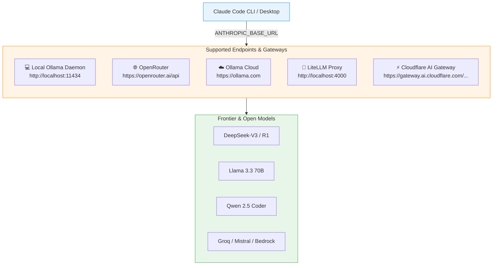

# 7. Alternative Providers & Custom Gateways

Claude Code is not locked to Anthropic's cloud. Because Claude Code communicates via the standardized **Anthropic Messages API (`/v1/messages`)**, you can point it to **any provider, gateway, or proxy** in the world simply by configuring `ANTHROPIC_BASE_URL` and `ANTHROPIC_AUTH_TOKEN`.



---

## 1. The Core Variable Pattern

Whenever Claude Code starts, it checks your environment (or your local [`.env`](file:///Users/cc/Desktop/claude-code-tutorial/.env.example) file) for three variables:

```bash
# 1. The target server endpoint
export ANTHROPIC_BASE_URL="<gateway-or-provider-url>"

# 2. Your authentication token (Bearer token)
export ANTHROPIC_AUTH_TOKEN="<your-provider-api-key>"

# 3. Empty out the official key so Claude doesn't ping Anthropic
export ANTHROPIC_API_KEY=""

# 4. Launch with the target provider's model ID
claude --model "<provider-model-id>"
```

---

## 2. Provider Configurations

### Provider 1: OpenRouter (Universal Aggregator)

[OpenRouter](https://openrouter.ai) exposes a unified Anthropic-compatible API endpoint. With a single OpenRouter API key, you can run DeepSeek, Meta Llama, Mistral, or Qwen through Claude Code.

**In `.env`:**
```env
ANTHROPIC_BASE_URL="https://openrouter.ai/api"
ANTHROPIC_AUTH_TOKEN="sk-or-v1-your-openrouter-key"
ANTHROPIC_API_KEY=""
CLAUDE_OLLAMA_MODEL="deepseek/deepseek-chat"
```

**Launch:**
```bash
./launch-claude-ollama.sh deepseek/deepseek-chat
```

Popular OpenRouter model IDs for coding:
- `deepseek/deepseek-chat` (DeepSeek-V3)
- `meta-llama/llama-3.3-70b-instruct`
- `qwen/qwen-2.5-coder-32b-instruct`

---

### Provider 2: Ollama Cloud (Serverless without Local Daemon)

If you don't want to run a local daemon on your Mac, connect directly to Ollama's managed infrastructure:

**In `.env`:**
```env
ANTHROPIC_BASE_URL="https://ollama.com"
ANTHROPIC_AUTH_TOKEN="your-ollama-api-key"
ANTHROPIC_API_KEY=""
CLAUDE_OLLAMA_MODEL="glm-5.3-flash"
```

**Launch:**
```bash
./launch-claude-ollama.sh glm-5.3-flash
```

---

### Provider 3: LiteLLM Proxy (Any LLM in the World)

[LiteLLM](https://github.com/BerriAI/litellm) is an open-source proxy that translates OpenAI, Groq, Cohere, Bedrock, and Azure into the Anthropic Messages format.

1. Install and start LiteLLM:
   ```bash
   pip install litellm
   litellm --model groq/llama-3.3-70b-versatile --port 4000
   ```
2. **In `.env`:**
   ```env
   ANTHROPIC_BASE_URL="http://localhost:4000"
   ANTHROPIC_AUTH_TOKEN="sk-litellm-any-key"
   ANTHROPIC_API_KEY=""
   CLAUDE_OLLAMA_MODEL="groq/llama-3.3-70b-versatile"
   ```
3. **Launch:**
   ```bash
   ./launch-claude-ollama.sh groq/llama-3.3-70b-versatile
   ```

---

### Provider 4: Cloudflare AI Gateway & Enterprise Proxies

For teams that need centralized audit logs, response caching, rate limits, and spend analytics:

```env
ANTHROPIC_BASE_URL="https://gateway.ai.cloudflare.com/v1/{account_id}/{gateway_name}/anthropic"
ANTHROPIC_AUTH_TOKEN="your-custom-gateway-token"
ANTHROPIC_API_KEY=""
CLAUDE_OLLAMA_MODEL="claude-3-5-sonnet-20241022"
```

---

## 3. The 2 Mandatory Requirements for Any Provider

Not every model or provider endpoint works automatically with Claude Code. Verify that the provider satisfies these two rules:

| Requirement | Why it's required | What happens if missing |
|---|---|---|
| **Anthropic Messages Schema (`/v1/messages`)** | Claude Code sends structured payloads expecting streaming Server-Sent Events (`text/event-stream`). | HTTP 404 or payload parsing error. |
| **Tool / Function Calling Support** | Claude Code is an agent that reads files (`View`), edits code (`Edit`), and runs bash (`Bash`). | The model will reply with text descriptions instead of executing real actions. |

---

## 4. Security & Best Practices

1. **Keep Secrets in `.env`:** Never hardcode API keys in `settings.json` or committed scripts.
2. **Verify `.gitignore`:** Ensure `.env` is listed in your project's `.gitignore` so tokens are never pushed to GitHub.
3. **Check Connection Status:** Whenever you change providers, run `/status` inside Claude Code to verify that the active URL and model match your target endpoint.

```text
> /status
Model: deepseek/deepseek-chat
API Base URL: https://openrouter.ai/api
Context Window: 200,000 tokens
```

✅ **Module complete.** Continue with [Lab 10 — Ollama & Local Models](../labs/lab-10-ollama.md).
