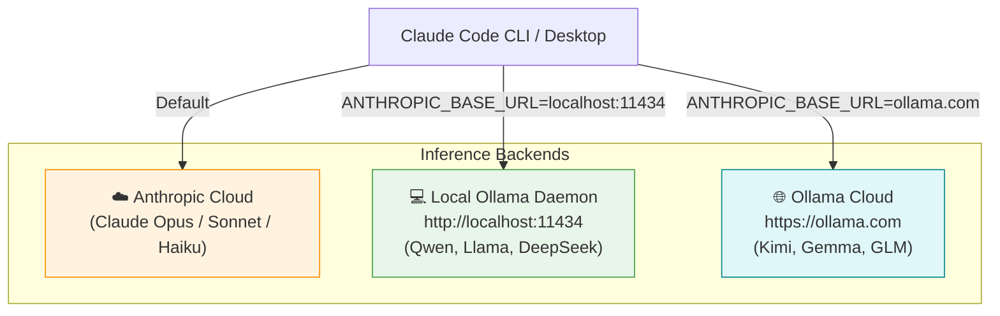
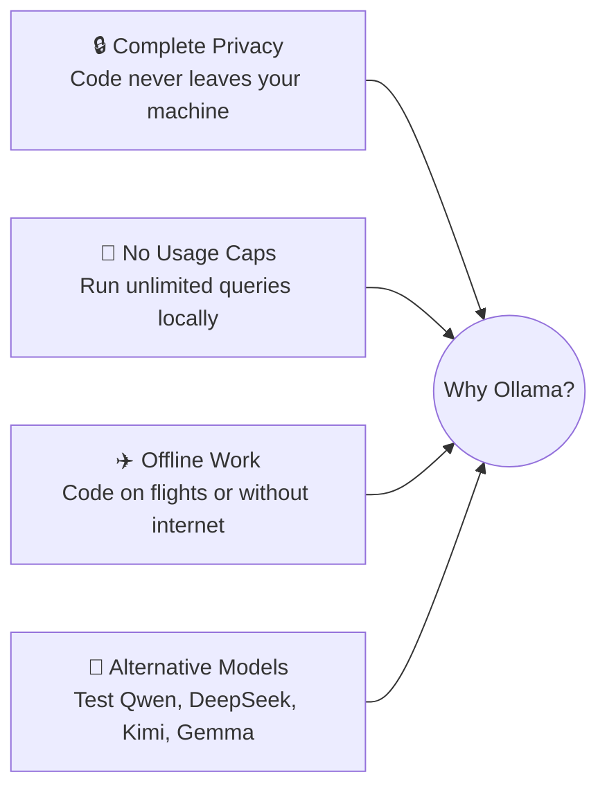

# Module 07 — Running with Ollama

**Goal:** connect Claude Code to local and cloud open-weights models through Ollama's Anthropic-compatible API for private, offline, or alternative-model workflows.

| # | Lesson | Time |
|---|---|---|
| 1 | [Quickstart & setup](01-quickstart-and-setup.md) | 10 min |
| 2 | [Selecting models & context](02-selecting-models-and-context.md) | 15 min |
| 3 | [Headless automation & `/loop`](03-headless-and-automation.md) | 10 min |
| 4 | [Cloud models & channels](04-cloud-and-channels.md) | 10 min |
| 5 | [Local model tactics & Storybook](05-local-model-tactics-and-storybook.md) | 15 min |
| 6 | [CLI tools & Python SDK](06-cli-tools-and-python-sdk.md) | 10 min |
| 7 | [Alternative providers & gateways](07-alternative-providers-and-gateways.md) | 10 min |

## How Ollama fits into Claude Code

Claude Code communicates using Anthropic's Messages API. Ollama provides an Anthropic-compatible API layer, allowing Claude Code to run against either local models running on your machine or Ollama Cloud models without changing how Claude Code works.

## Supported capabilities

| Capability | Supported with Ollama | Notes |
|---|---|---|
| **Chat & code reasoning** | ✅ | Ask questions about codebases and architectures |
| **Command-line execution** | ✅ | Runs build, test, and shell commands with standard permission checks |
| **Tool calling** | ✅ | Works with compatible models (e.g. Qwen 2.5/3.5, Llama 3.3) |
| **File edits** | ✅ | Reading, diffing, and writing files |
| **Subagents** | ✅ | Delegating subtasks with separate context windows |
| **Web search & fetch** | ✅ | Uses Ollama's web search API |
| **Vision** | ✅ | Analyze images and UI screenshots with multimodal models |
| **Thinking** | ✅ | Supported on thinking-enabled models |
| **Scheduled tasks** | ✅ | Native `/loop` command for recurring prompts |
| **Channels** | ✅ | Remote access via Telegram bot integration |

## Why run with Ollama?

**Checkpoint:** understand how to launch Claude Code with local models, configure environment variables, choose high-context models, and automate tasks with `/loop`.

➡️ Practice: [Lab 10 — Ollama & Local Models](../labs/lab-10-ollama.md)
