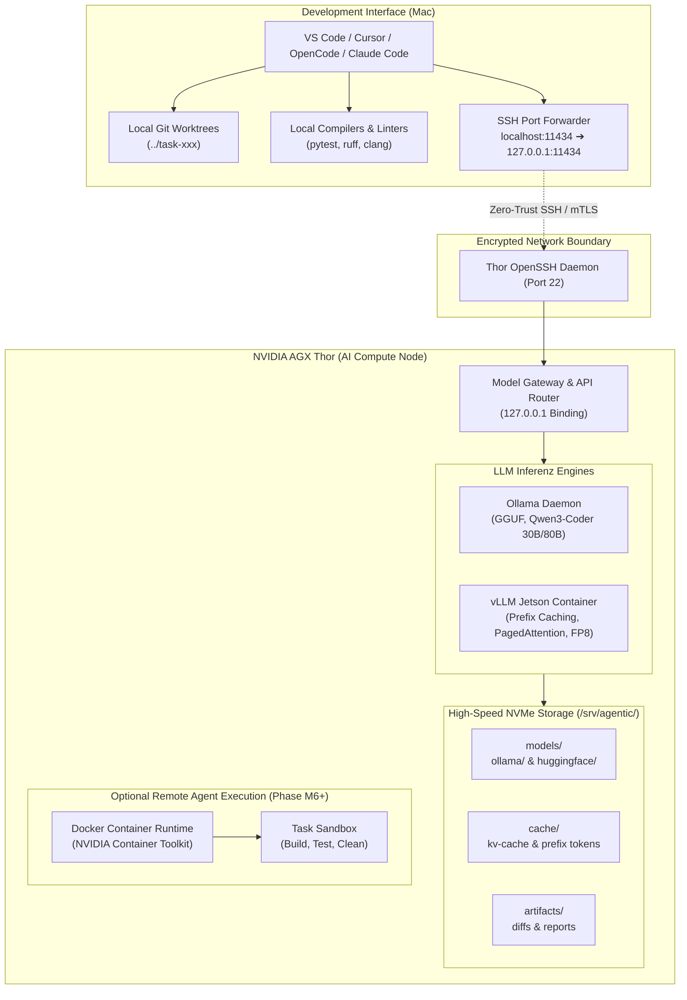

# Target Architecture & Hybrid Topology

Building a reliable, local-first agentic coding platform requires clear separation between **user interaction**, **model inference**, and **tool execution**.

---

## 1. System Topology Overview



---

## 2. Core Architecture Principles

### 1. Separate Inference from Execution
The LLM compute server must remain responsive and resilient. It does not provide an unrestricted shell directly to the model.
- **Inference Server**: Performs token generation and returns structured tool-call arguments.
- **Agent Runtime**: Evaluates tool calls, enforces permission boundaries, executes actions in isolated environments, and feeds back structured outputs.

### 2. Task Isolation via Git Worktrees
No agent writes directly to active feature or main branches. Every task is given an isolated Git worktree:
```bash
git worktree add ../task-feature-x -b agent/task-feature-x
```
This isolates concurrent edits, prevents broken build environments from polluting the repository, and makes rollback instantaneous.

### 3. Interchangeable Model Engines
The architecture couples to standard APIs (**Anthropic Messages API** and **OpenAI `/v1` format**), not specific vendor binaries.
- Transitioning from Ollama to vLLM requires updating the backend port or URL without altering agent prompts or project code.

### 4. Measurable and Verifiable Diffs
Every proposed modification must exist as a standard Git diff. Success is measured by concrete execution results:
- Does the code compile?
- Do regression tests pass (`pytest`, `colcon test`, `ctest`)?
- Does the static analysis report zero new violations?

### 5. Fail-Closed Boundaries for Hardware and Production
No automated system should possess permissions to:
- Push to protected branches (`main`, `release/*`).
- Flash connected microcontrollers (`st-flash`, `openocd`).
- Release PCB Gerber or drill files for manufacturing.
These operations must remain gated behind explicit human operator authorization.

---

## 3. Resource Partitioning on AGX Thor (128 GB Unified Memory)

Because the AGX Thor uses unified LPDDR5X memory shared between CPU and GPU, careful budgeting is required to prevent Linux Out-Of-Memory (OOM) aborts:

| Memory Component | Allocation | Role & Usage Notes |
|---|---|---|
| **JetPack 7.x OS & System Services** | ~4 GB | Linux kernel, systemd, SSH, Docker daemon |
| **Model Weights (Qwen3-Coder 30B MoE Q4)** | ~19 GB | Active working model for day-to-day coding |
| **Model Weights (Qwen3-Coder-Next 80B Q4)** | ~52 GB | High-capacity model for complex refactoring |
| **PagedAttention KV-Cache (64k context)** | ~16–28 GB | Context retention across multi-turn agent sessions |
| **Reserved Operational Headroom** | ~35–45 GB | Build processes, compiler invocations, I/O buffers |

> [!IMPORTANT]
> Never let compiler toolchains (e.g., parallel `ninja` or `colcon` builds) run on Thor without strict cgroup memory caps (`docker run --memory 16g`) when an 80B model is loaded.
